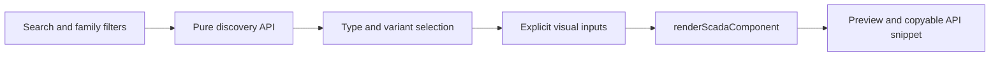

# Single-component browser example

[Examples map](../README.md) · [Package map](../../README.md) · [Component API](../../docs/API.md) · [Catalog owner](../../src/catalog/README.md)

[index.html](./index.html) is a self-contained example page with its small host controls and module script inline. It imports the public component/catalog facades and component stylesheet. Search and family filters choose a descriptor; variant selection preserves the type identity; Active, Animate and Fault supply visual state to the same renderer used elsewhere.

Run `python -m http.server 8000` from the package root and open `http://localhost:8000/examples/components/`. The displayed code follows the current selection. The example deliberately exposes only a few common controls; the authoritative full field/port list comes from the descriptor, [API](../../docs/API.md) and [state coverage review](../../docs/STATE_COVERAGE.md).

There is no model, plant session or command adapter here. Changing a checkbox changes a local illustration. Use the [viewer example](../viewer/README.md) to connect system-level state and commands. Extend this example without importing the host app or adding timers to the symbol library.

