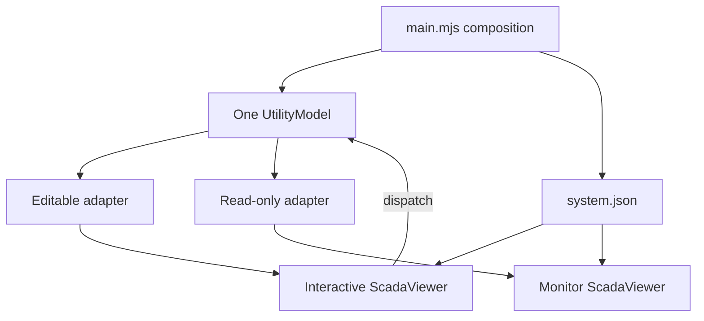
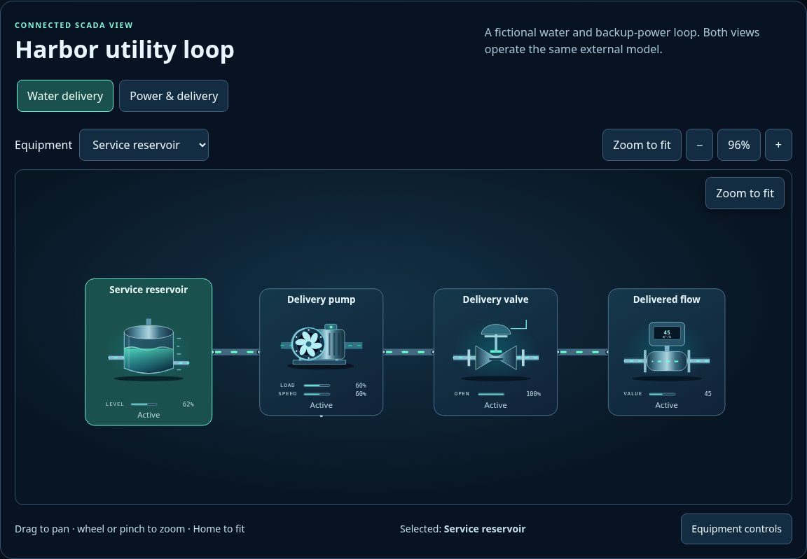

# One external model, two SCADA viewers

[Examples map](../README.md) · [Package map](../../README.md) · [Viewer API](../../docs/API.md#viewer-api) · [System format](../../docs/SYSTEM_FORMAT.md)

This fictional utility example demonstrates an editable viewer and a read-only monitor sharing one `UtilityModel`. Water and power layouts are views of that same state. Faulting the generator, changing demand or operating a valve goes through the adapter rather than a private diagram model.

| File | Responsibility |
| --- | --- |
| [index.html](./index.html) | Page containers, example transport controls and shared package stylesheet imports. |
| [main.mjs](./main.mjs) | Fetch definition, construct one model, mount both viewers, bind example controls and own page lifecycle. |
| [system.json](./system.json) | Equipment identity, layouts, routes, explicit bindings and controls. |
| [utility-model.mjs](./utility-model.mjs) | Fictional state, commands, subscriptions and a single example clock; no UI imports. |
| [utility-adapter.mjs](./utility-adapter.mjs) | Translate model snapshots to visual state; omit dispatch for the read-only monitor. |
| [styles.css](./styles.css) | Example page layout, separate from the reusable viewer skin. |

From the package root, run `python -m http.server 8000` and open `http://localhost:8000/examples/viewer/`. The model advances one fictional minute per visible running tick. Step pauses first. Page visibility gates automatic advancement; page teardown stops the model and destroys owned viewer subscriptions/listeners. The view never owns the plant clock.

Use this separation when integrating another model: keep the system document, replace `UtilityModel` and adapter translation, and retain the shared viewer/workspace interfaces. This small example does not implement the full [SCADA simulation package](../../../sim/README.md), calibrated equipment or a complete fault lifecycle.

