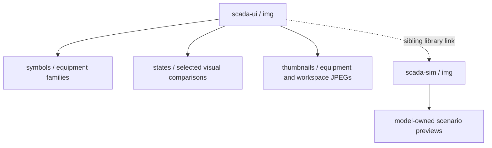

# SCADA UI image gallery

[Package owner](../README.md) · [Equipment map](symbols/README.md) · [Interactive example](../examples/components/index.html) · [State examples](states/README.md) · [UI snapshots](thumbnails/README.md)

Each library owns its own `img/` directory. This package owns equipment artwork, visual states and viewer/workspace previews. [Simulation scenario previews](../../sim/img/README.md) belong to the separate model package.

The catalog contains 239 generated SVG previews. SVG images contain the canonical equipment artwork, native SVG text/readouts and inline CSS animation; no scripts, external styles, fonts or images. GitHub and other Markdown renderers can display them using ordinary relative image links. Animation support depends on the renderer; the first frame remains useful. The live examples provide interactive state controls.

All displayed values and selected states are illustrative, editable rendering inputs. An animated picture is not a process model. Read [the style guide](../STYLE_GUIDE.md) and [contribution guide](../CONTRIBUTING.md) before adding assets.

| Folder | Contents and use |
| --- | --- |
| [symbols/](symbols/README.md) | Every default type and declared variant, grouped by equipment family. |
| [states/](states/README.md) | 31 illustrative comparisons for motion, availability, damage and retained inventory. |
| [thumbnails/](thumbnails/README.md) | Static equipment, variant, state and reusable UI captures. |

Generate SVGs and these maps with `npm run gallery:generate`; verify with `npm run gallery:check`. See the [export contract](../docs/GALLERY_EXPORT.md) and [gallery manifest](../metadata/gallery.json) for provenance and checks.

| Family | Previews | Sample |
| --- | --- | --- |
| [Process vessels](symbols/process/README.md) | 39 |  |
| [Pumps &amp; machinery](symbols/rotating/README.md) | 24 |  |
| [Power &amp; energy](symbols/power/README.md) | 55 |  |
| [Valves](symbols/valves/README.md) | 45 |  |
| [Instruments](symbols/instruments/README.md) | 8 |  |
| [PLC &amp; networks](symbols/automation/README.md) | 7 |  |
| [Connections](symbols/connections/README.md) | 10 |  |
| [Manufacturing &amp; solids](symbols/manufacturing/README.md) | 18 |  |
| [Nuclear systems](symbols/nuclear/README.md) | 19 |  |
| [Growing &amp; aquaculture](symbols/agriculture/README.md) | 10 |  |
| [Climate control](symbols/climate/README.md) | 4 |  |
