# Visual state examples

[Parent map](../README.md) · [Gallery](../README.md) · [Package owner](../../README.md) · [Interactive equipment example](../../examples/components/index.html)

Generated from the library renderer. These images show supplied illustrative visual state; they do not run a system model. Motion follows the image viewer’s reduced-motion preference where supported. Static renderers retain the equipment and readouts.

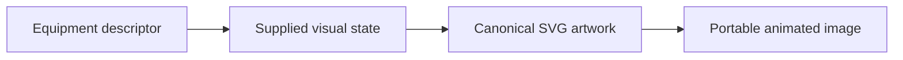

This folder contains **31 previews**. Open an image for its full size; use the interactive example to change fields. The table lists the rendering inputs for each asset. Regenerate this map with `npm run gallery:generate`; do not edit generated SVGs or indexes.

| Preview | Equipment and supplied state |
| --- | --- |
|  | **Centrifugal pump** `pump` Inactive · illustrative  Distinct pump volute, motor, flange connections and spinning impeller.  Editable fields: `active`, `running`, `fault`, `status`, `load`, `speed`, `damage`. |
|  | **Centrifugal pump** `pump` Animation paused · illustrative  Distinct pump volute, motor, flange connections and spinning impeller.  Editable fields: `active`, `running`, `fault`, `status`, `load`, `speed`, `damage`. |
|  | **Centrifugal pump** `pump` 20% speed and load · illustrative  Distinct pump volute, motor, flange connections and spinning impeller.  Editable fields: `active`, `running`, `fault`, `status`, `load`, `speed`, `damage`. |
|  | **Centrifugal pump** `pump` 90% speed and load · illustrative  Distinct pump volute, motor, flange connections and spinning impeller.  Editable fields: `active`, `running`, `fault`, `status`, `load`, `speed`, `damage`. |
|  | **Centrifugal pump** `pump` Warning · illustrative  Distinct pump volute, motor, flange connections and spinning impeller.  Editable fields: `active`, `running`, `fault`, `status`, `load`, `speed`, `damage`. |
|  | **Centrifugal pump** `pump` Fault · illustrative  Distinct pump volute, motor, flange connections and spinning impeller.  Editable fields: `active`, `running`, `fault`, `status`, `load`, `speed`, `damage`. |
|  | **Centrifugal pump** `pump` Offline · illustrative  Distinct pump volute, motor, flange connections and spinning impeller.  Editable fields: `active`, `running`, `fault`, `status`, `load`, `speed`, `damage`. |
|  | **Centrifugal pump** `pump` Leak · illustrative  Distinct pump volute, motor, flange connections and spinning impeller.  Editable fields: `active`, `running`, `fault`, `status`, `load`, `speed`, `damage`. |
|  | **Storage tank** `tank` 0% inventory · illustrative  Glass-sided cylindrical tank with level scale, inlet and outlet.  Editable fields: `active`, `running`, `fault`, `status`, `level`, `damage`. |
|  | **Storage tank** `tank` 100% inventory · illustrative  Glass-sided cylindrical tank with level scale, inlet and outlet.  Editable fields: `active`, `running`, `fault`, `status`, `level`, `damage`. |
|  | **Storage tank** `tank` Rupture · illustrative  Glass-sided cylindrical tank with level scale, inlet and outlet.  Editable fields: `active`, `running`, `fault`, `status`, `level`, `damage`. |
|  | **Diesel generator skid — Diesel / skid** `generator` / `diesel-skid` Diesel genset operating · illustrative  Original skid packaged-generator illustration with an explicit diesel inlet. Capacity and dynamics come from the external model.  Editable fields: `active`, `running`, `fault`, `status`, `load`, `speed`, `damage`. |
|  | **Gasoline generator portable frame — Gasoline / portable** `generator` / `gasoline-portable` Gasoline genset fault · illustrative  Original portable frame packaged-generator illustration with an explicit gasoline inlet. Capacity and dynamics come from the external model.  Editable fields: `active`, `running`, `fault`, `status`, `load`, `speed`, `damage`. |
|  | **PLC rack** `plc-rack` Connected · illustrative  Power supply, CPU and modular IO on a common backplane.  Editable fields: `active`, `running`, `fault`, `status`, `connected`, `load`, `damage`. |
| <a href="plc-rack--disconnected.svg"></a> | **PLC rack** `plc-rack` Disconnected · illustrative  Power supply, CPU and modular IO on a common backplane.  Editable fields: `active`, `running`, `fault`, `status`, `connected`, `load`, `damage`. |
|  | **Control valve** `control-valve` Closed · illustrative  Process valve with a pneumatic diaphragm actuator and control signal.  Editable fields: `active`, `running`, `fault`, `status`, `open`, `opening`, `damage`. |
| <a href="control-valve--part-open.svg"></a> | **Control valve** `control-valve` 35% open · illustrative  Process valve with a pneumatic diaphragm actuator and control signal.  Editable fields: `active`, `running`, `fault`, `status`, `open`, `opening`, `damage`. |
|  | **Control valve** `control-valve` Fully open · illustrative  Process valve with a pneumatic diaphragm actuator and control signal.  Editable fields: `active`, `running`, `fault`, `status`, `open`, `opening`, `damage`. |
| <a href="flare--burning.svg"></a> | **Flare stack** `flare` Flame active · illustrative  Shared controlled-flare illustration with layered flame and embers.  Editable fields: `active`, `running`, `fault`, `status`, `load`, `damage`. |
| <a href="flare--inactive.svg"></a> | **Flare stack** `flare` Flame inactive · illustrative  Shared controlled-flare illustration with layered flame and embers.  Editable fields: `active`, `running`, `fault`, `status`, `load`, `damage`. |
|  | **Pressurized-water reactor vessel** `pwr-reactor-vessel` Separate coolant circuits · fictional indices  Conceptual water-cooled vessel with supplied inventory, circulation, rod insertion and residual thermal state.  Editable fields: `active`, `running`, `fault`, `status`, `load`, `heat`, `flow`, `level`, `rodPosition`, `damage`. |
| <a href="pwr-reactor-vessel--inactive.svg"></a> | **Pressurized-water reactor vessel** `pwr-reactor-vessel` Production inactive · supplied heat retained  Conceptual water-cooled vessel with supplied inventory, circulation, rod insertion and residual thermal state.  Editable fields: `active`, `running`, `fault`, `status`, `load`, `heat`, `flow`, `level`, `rodPosition`, `damage`. |
|  | **Solar array** `solar-panel` No supplied solar activity · illustrative  Tilted photovoltaic panel with individual cells and a DC lead.  Editable fields: `active`, `running`, `fault`, `status`, `load`, `damage`. |
|  | **Three-phase separator** `separator` Distinct process streams · illustrative  Horizontal settling vessel showing separate fluid layers and a gas outlet.  Editable fields: `active`, `running`, `fault`, `status`, `level`, `load`, `damage`. |
| <a href="greenhouse-vent--closed.svg"></a> | **Greenhouse vent** `greenhouse-vent` Closed · no supplied airflow  Hinged roof vent with explicit position and an independent air path.  Editable fields: `active`, `running`, `fault`, `status`, `opening`, `airflow`, `damage`. |
| <a href="greenhouse-vent--open.svg"></a> | **Greenhouse vent** `greenhouse-vent` 80% opening · 75% airflow index  Hinged roof vent with explicit position and an independent air path.  Editable fields: `active`, `running`, `fault`, `status`, `opening`, `airflow`, `damage`. |
| <a href="nft-channel--inactive.svg"></a> | **Nutrient-film channel** `nft-channel` Feed inactive · retained moisture  Shallow solution channel with exposed root positions and gravity return.  Editable fields: `active`, `running`, `fault`, `status`, `moisture`, `load`, `damage`. |
| <a href="oven--conveying.svg"></a> | **Conveyor oven** `oven` Continuous conveyor oven · illustrative  Cutaway heating tunnel with upper and lower heating coils, a moving metal belt and traveling product trays.  Editable fields: `active`, `running`, `fault`, `status`, `load`, `temperature`, `damage`. |
|  | **Rack / batch oven** `rack-oven` Batch chamber open · heating inactive  Front-loading electric batch oven with stationary product shelves, a hinged inspection door, recirculating air and retained thermal glow.  Editable fields: `active`, `running`, `fault`, `status`, `load`, `temperature`, `open`, `damage`. |
| <a href="current-transformer--inactive.svg"></a> | **Current transformer** `current-transformer` De-energized · sensing disconnected  Instrument-transformer measurement tap and signal output, not a power-consuming feeder.  Editable fields: `active`, `running`, `fault`, `status`, `value`, `connected`, `damage`. |
|  | **Protection relay** `protection-relay` Trip contact active · monitoring retained  Measurement input, communications and trip output with no implied certified protection curve.  Editable fields: `active`, `running`, `fault`, `status`, `value`, `connected`, `tripped`, `damage`. |
