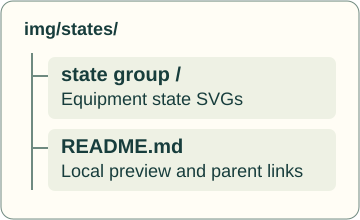

# Visual state examples

[Parent map](../README.md) · [Package owner](../../README.md) · [Image gallery](../README.md)

Generated previews from canonical equipment artwork and supplied illustrative state. Images do not run a process model. Open a preview for its full size.

| Map | Purpose |
| --- | --- |
| [gallery-map.svg](gallery-map.svg) | Shared ownership map for this generated gallery. |

| Folder | Previews | Example |
| --- | ---: | --- |
| [Availability](availability/README.md) | 10 |  |
| [Damage And Alarms](damage-and-alarms/README.md) | 6 |  |
| [Levels And Controls](levels-and-controls/README.md) | 10 |  |
| [Operating](operating/README.md) | 5 |  |
