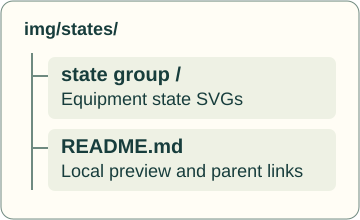

# Availability

[Parent map](../README.md) · [Package owner](../../../README.md) · [Image gallery](../../README.md)

Generated previews from canonical equipment artwork and supplied illustrative state. Images do not run a process model. Open a preview for its full size.

| File | Preview | Equipment and supplied state |
| --- | --- | --- |
| [pump--inactive.svg](pump--inactive.svg) |  | Centrifugal pump Inactive · illustrative `pump` Editable fields: `active`, `running`, `fault`, `status`, `load`, `speed`, `damage` |
| [pump--paused.svg](pump--paused.svg) |  | Centrifugal pump Animation paused · illustrative `pump` Editable fields: `active`, `running`, `fault`, `status`, `load`, `speed`, `damage` |
| [pump--offline.svg](pump--offline.svg) |  | Centrifugal pump Offline · illustrative `pump` Editable fields: `active`, `running`, `fault`, `status`, `load`, `speed`, `damage` |
| [plc-rack--connected.svg](plc-rack--connected.svg) |  | PLC rack Connected · illustrative `plc-rack` Editable fields: `active`, `running`, `fault`, `status`, `connected`, `load`, `damage` |
| [plc-rack--disconnected.svg](plc-rack--disconnected.svg) |  | PLC rack Disconnected · illustrative `plc-rack` Editable fields: `active`, `running`, `fault`, `status`, `connected`, `load`, `damage` |
| [flare--inactive.svg](flare--inactive.svg) |  | Flare stack Flame inactive · illustrative `flare` Editable fields: `active`, `running`, `fault`, `status`, `load`, `damage` |
| [pwr-reactor-vessel--inactive.svg](pwr-reactor-vessel--inactive.svg) |  | Pressurized-water reactor vessel Production inactive · supplied heat retained `pwr-reactor-vessel` Editable fields: `active`, `running`, `fault`, `status`, `load`, `heat`, `flow`, `level`, `rodPosition`, `damage` |
| [solar-panel--inactive.svg](solar-panel--inactive.svg) |  | Solar array No supplied solar activity · illustrative `solar-panel` Editable fields: `active`, `running`, `fault`, `status`, `load`, `damage` |
| [nft-channel--inactive.svg](nft-channel--inactive.svg) |  | Nutrient-film channel Feed inactive · retained moisture `nft-channel` Editable fields: `active`, `running`, `fault`, `status`, `moisture`, `load`, `damage` |
| [current-transformer--inactive.svg](current-transformer--inactive.svg) |  | Current transformer De-energized · sensing disconnected `current-transformer` Editable fields: `active`, `running`, `fault`, `status`, `value`, `connected`, `damage` |
