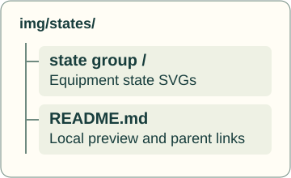

# Damage And Alarms

[Parent map](../README.md) · [Package owner](../../../README.md) · [Image gallery](../../README.md)

Generated previews from canonical equipment artwork and supplied illustrative state. Images do not run a process model. Open a preview for its full size.

| File | Preview | Equipment and supplied state |
| --- | --- | --- |
| [pump--warning.svg](pump--warning.svg) |  | Centrifugal pump Warning · illustrative `pump` Editable fields: `active`, `running`, `fault`, `status`, `load`, `speed`, `damage` |
| [pump--fault.svg](pump--fault.svg) |  | Centrifugal pump Fault · illustrative `pump` Editable fields: `active`, `running`, `fault`, `status`, `load`, `speed`, `damage` |
| [pump--leaking.svg](pump--leaking.svg) |  | Centrifugal pump Leak · illustrative `pump` Editable fields: `active`, `running`, `fault`, `status`, `load`, `speed`, `damage` |
| [tank--ruptured.svg](tank--ruptured.svg) |  | Storage tank Rupture · illustrative `tank` Editable fields: `active`, `running`, `fault`, `status`, `level`, `damage` |
| [generator--gasoline-portable--fault.svg](generator--gasoline-portable--fault.svg) |  | Gasoline generator portable frame — Gasoline / portable Gasoline genset fault · illustrative `generator` / `gasoline-portable` Editable fields: `active`, `running`, `fault`, `status`, `load`, `speed`, `damage` |
| [protection-relay--tripped.svg](protection-relay--tripped.svg) |  | Protection relay Trip contact active · monitoring retained `protection-relay` Editable fields: `active`, `running`, `fault`, `status`, `value`, `connected`, `tripped`, `damage` |
