# Levels And Controls

[Parent map](../README.md) · [Package owner](../../../README.md) · [Image gallery](../../README.md)

Generated previews from canonical equipment artwork and supplied illustrative state. Images do not run a process model. Open a preview for its full size.

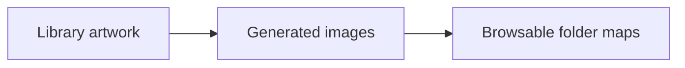

| File | Preview | Equipment and supplied state |
| --- | --- | --- |
| [pump--low-speed.svg](pump--low-speed.svg) | <a href="pump--low-speed.svg"></a> | Centrifugal pump 20% speed and load · illustrative `pump` Editable fields: `active`, `running`, `fault`, `status`, `load`, `speed`, `damage` |
| [pump--high-speed.svg](pump--high-speed.svg) | <a href="pump--high-speed.svg"></a> | Centrifugal pump 90% speed and load · illustrative `pump` Editable fields: `active`, `running`, `fault`, `status`, `load`, `speed`, `damage` |
| [tank--empty.svg](tank--empty.svg) | <a href="tank--empty.svg"></a> | Storage tank 0% inventory · illustrative `tank` Editable fields: `active`, `running`, `fault`, `status`, `level`, `damage` |
| [tank--full.svg](tank--full.svg) | <a href="tank--full.svg"></a> | Storage tank 100% inventory · illustrative `tank` Editable fields: `active`, `running`, `fault`, `status`, `level`, `damage` |
| [control-valve--closed.svg](control-valve--closed.svg) | <a href="control-valve--closed.svg"></a> | Control valve Closed · illustrative `control-valve` Editable fields: `active`, `running`, `fault`, `status`, `open`, `opening`, `damage` |
| [control-valve--part-open.svg](control-valve--part-open.svg) | <a href="control-valve--part-open.svg"></a> | Control valve 35% open · illustrative `control-valve` Editable fields: `active`, `running`, `fault`, `status`, `open`, `opening`, `damage` |
| [control-valve--open.svg](control-valve--open.svg) | <a href="control-valve--open.svg"></a> | Control valve Fully open · illustrative `control-valve` Editable fields: `active`, `running`, `fault`, `status`, `open`, `opening`, `damage` |
| [greenhouse-vent--closed.svg](greenhouse-vent--closed.svg) | <a href="greenhouse-vent--closed.svg"></a> | Greenhouse vent Closed · no supplied airflow `greenhouse-vent` Editable fields: `active`, `running`, `fault`, `status`, `opening`, `airflow`, `damage` |
| [greenhouse-vent--open.svg](greenhouse-vent--open.svg) | <a href="greenhouse-vent--open.svg"></a> | Greenhouse vent 80% opening · 75% airflow index `greenhouse-vent` Editable fields: `active`, `running`, `fault`, `status`, `opening`, `airflow`, `damage` |
| [rack-oven--door-open.svg](rack-oven--door-open.svg) | <a href="rack-oven--door-open.svg"></a> | Rack / batch oven Batch chamber open · heating inactive `rack-oven` Editable fields: `active`, `running`, `fault`, `status`, `load`, `temperature`, `open`, `damage` |
