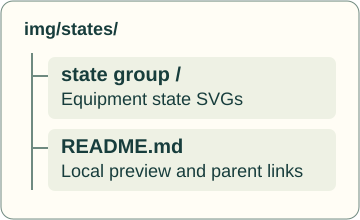

# Operating

[Parent map](../README.md) · [Package owner](../../../README.md) · [Image gallery](../../README.md)

Generated previews from canonical equipment artwork and supplied illustrative state. Images do not run a process model. Open a preview for its full size.

| File | Preview | Equipment and supplied state |
| --- | --- | --- |
| [generator--diesel-skid--operating.svg](generator--diesel-skid--operating.svg) |  | Diesel generator skid — Diesel / skid Diesel genset operating · illustrative `generator` / `diesel-skid` Editable fields: `active`, `running`, `fault`, `status`, `load`, `speed`, `damage` |
| [flare--burning.svg](flare--burning.svg) |  | Flare stack Flame active · illustrative `flare` Editable fields: `active`, `running`, `fault`, `status`, `load`, `damage` |
| [pwr-reactor-vessel--operating.svg](pwr-reactor-vessel--operating.svg) |  | Pressurized-water reactor vessel Separate coolant circuits · fictional indices `pwr-reactor-vessel` Editable fields: `active`, `running`, `fault`, `status`, `load`, `heat`, `flow`, `level`, `rodPosition`, `damage` |
| [separator--operating.svg](separator--operating.svg) |  | Three-phase separator Distinct process streams · illustrative `separator` Editable fields: `active`, `running`, `fault`, `status`, `level`, `load`, `damage` |
| [oven--conveying.svg](oven--conveying.svg) |  | Conveyor oven Continuous conveyor oven · illustrative `oven` Editable fields: `active`, `running`, `fault`, `status`, `load`, `temperature`, `damage` |
