# Valve Position

[Parent map](../README.md) · [Package owner](../../../README.md) · [Image gallery](../../README.md)

Generated previews from canonical equipment artwork and supplied illustrative state. Images do not run a process model. Open a preview for its full size.

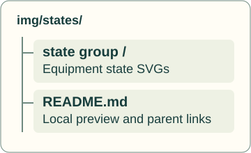

| File | Preview | Equipment and supplied state |
| --- | --- | --- |
| [gate-valve--closed.svg](gate-valve--closed.svg) | <a href="gate-valve--closed.svg"></a> | Gate valve Closed · supplied illustrative position `gate-valve` Editable fields: `active`, `running`, `fault`, `status`, `open`, `opening`, `damage` |
| [gate-valve--part-open.svg](gate-valve--part-open.svg) | <a href="gate-valve--part-open.svg"></a> | Gate valve 35% open · supplied illustrative position `gate-valve` Editable fields: `active`, `running`, `fault`, `status`, `open`, `opening`, `damage` |
| [gate-valve--open.svg](gate-valve--open.svg) | <a href="gate-valve--open.svg"></a> | Gate valve Fully open · supplied illustrative position `gate-valve` Editable fields: `active`, `running`, `fault`, `status`, `open`, `opening`, `damage` |
| [control-valve--closed.svg](control-valve--closed.svg) | <a href="control-valve--closed.svg"></a> | Control valve Closed · supplied illustrative position `control-valve` Editable fields: `active`, `running`, `fault`, `status`, `open`, `opening`, `damage` |
| [control-valve--part-open.svg](control-valve--part-open.svg) | <a href="control-valve--part-open.svg"></a> | Control valve 35% open · supplied illustrative position `control-valve` Editable fields: `active`, `running`, `fault`, `status`, `open`, `opening`, `damage` |
| [control-valve--open.svg](control-valve--open.svg) | <a href="control-valve--open.svg"></a> | Control valve Fully open · supplied illustrative position `control-valve` Editable fields: `active`, `running`, `fault`, `status`, `open`, `opening`, `damage` |
| [check-valve--closed.svg](check-valve--closed.svg) | <a href="check-valve--closed.svg"></a> | Check valve Closed · supplied illustrative position `check-valve` Editable fields: `active`, `running`, `fault`, `status`, `open`, `damage` |
| [check-valve--open.svg](check-valve--open.svg) | <a href="check-valve--open.svg"></a> | Check valve Fully open · supplied illustrative position `check-valve` Editable fields: `active`, `running`, `fault`, `status`, `open`, `damage` |
| [relief-valve--closed.svg](relief-valve--closed.svg) | <a href="relief-valve--closed.svg"></a> | Pressure relief valve Closed · supplied illustrative position `relief-valve` Editable fields: `active`, `running`, `fault`, `status`, `open`, `damage` |
| [relief-valve--open.svg](relief-valve--open.svg) | <a href="relief-valve--open.svg"></a> | Pressure relief valve Fully open · supplied illustrative position `relief-valve` Editable fields: `active`, `running`, `fault`, `status`, `open`, `damage` |
| [butterfly-valve--closed.svg](butterfly-valve--closed.svg) | <a href="butterfly-valve--closed.svg"></a> | Butterfly valve Closed · supplied illustrative position `butterfly-valve` Editable fields: `active`, `running`, `fault`, `status`, `open`, `opening`, `damage` |
| [butterfly-valve--part-open.svg](butterfly-valve--part-open.svg) | <a href="butterfly-valve--part-open.svg"></a> | Butterfly valve 35% open · supplied illustrative position `butterfly-valve` Editable fields: `active`, `running`, `fault`, `status`, `open`, `opening`, `damage` |
| [butterfly-valve--open.svg](butterfly-valve--open.svg) | <a href="butterfly-valve--open.svg"></a> | Butterfly valve Fully open · supplied illustrative position `butterfly-valve` Editable fields: `active`, `running`, `fault`, `status`, `open`, `opening`, `damage` |
| [fuel-pressure-regulator--closed.svg](fuel-pressure-regulator--closed.svg) | <a href="fuel-pressure-regulator--closed.svg"></a> | Fuel pressure regulator Closed · supplied illustrative position `fuel-pressure-regulator` Editable fields: `active`, `running`, `fault`, `status`, `open`, `opening`, `pressure`, `flow`, `damage` |
| [fuel-pressure-regulator--part-open.svg](fuel-pressure-regulator--part-open.svg) | <a href="fuel-pressure-regulator--part-open.svg"></a> | Fuel pressure regulator 35% open · supplied illustrative position `fuel-pressure-regulator` Editable fields: `active`, `running`, `fault`, `status`, `open`, `opening`, `pressure`, `flow`, `damage` |
| [fuel-pressure-regulator--open.svg](fuel-pressure-regulator--open.svg) | <a href="fuel-pressure-regulator--open.svg"></a> | Fuel pressure regulator Fully open · supplied illustrative position `fuel-pressure-regulator` Editable fields: `active`, `running`, `fault`, `status`, `open`, `opening`, `pressure`, `flow`, `damage` |
| [intake-gate--closed.svg](intake-gate--closed.svg) | <a href="intake-gate--closed.svg"></a> | Hydraulic intake gate Closed · supplied illustrative position `intake-gate` Editable fields: `active`, `running`, `fault`, `status`, `open`, `opening`, `damage` |
| [intake-gate--part-open.svg](intake-gate--part-open.svg) | <a href="intake-gate--part-open.svg"></a> | Hydraulic intake gate 35% open · supplied illustrative position `intake-gate` Editable fields: `active`, `running`, `fault`, `status`, `open`, `opening`, `damage` |
| [intake-gate--open.svg](intake-gate--open.svg) | <a href="intake-gate--open.svg"></a> | Hydraulic intake gate Fully open · supplied illustrative position `intake-gate` Editable fields: `active`, `running`, `fault`, `status`, `open`, `opening`, `damage` |
