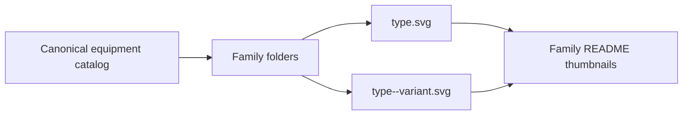

# Equipment previews

[Parent gallery](../README.md) · [Package owner](../../README.md) · [State comparisons](../states/README.md)

**239 default and variant previews** share the canonical equipment renderer. Each family folder contains its own Markdown index with image thumbnails, editable fields and descriptions.

These files are generated rendering examples. Catalog definitions and artwork live under the [source owner](../../src/README.md). Run `npm run gallery:generate` after changing an asset; `npm run gallery:check` verifies inventory and output freshness.

| Family folder | Previews | Sample |
| --- | --- | --- |
| [Process vessels](process/README.md) | 39 |  |
| [Pumps &amp; machinery](rotating/README.md) | 24 |  |
| [Power &amp; energy](power/README.md) | 55 |  |
| [Valves](valves/README.md) | 45 |  |
| [Instruments](instruments/README.md) | 8 |  |
| [PLC &amp; networks](automation/README.md) | 7 |  |
| [Connections](connections/README.md) | 10 |  |
| [Manufacturing &amp; solids](manufacturing/README.md) | 18 |  |
| [Nuclear systems](nuclear/README.md) | 19 |  |
| [Growing &amp; aquaculture](agriculture/README.md) | 10 |  |
| [Climate control](climate/README.md) | 4 |  |
