# Equipment previews

[Parent map](../README.md) · [Package owner](../../README.md) · [Image gallery](../README.md)

Generated previews from canonical equipment artwork and supplied illustrative state. Images do not run a process model. Open a preview for its full size.

| Map | Purpose |
| --- | --- |
| [gallery-map.svg](gallery-map.svg) | Shared ownership map for this generated gallery. |

| Folder | Previews | Example |
| --- | ---: | --- |
| [Growing &amp; aquaculture](agriculture/README.md) | 10 |  |
| [PLC &amp; networks](automation/README.md) | 7 |  |
| [Climate control](climate/README.md) | 4 |  |
| [Connections](connections/README.md) | 10 |  |
| [Instruments](instruments/README.md) | 8 |  |
| [Manufacturing &amp; solids](manufacturing/README.md) | 18 |  |
| [Nuclear systems](nuclear/README.md) | 19 |  |
| [Power &amp; energy](power/README.md) | 55 |  |
| [Process vessels](process/README.md) | 39 |  |
| [Pumps &amp; machinery](rotating/README.md) | 24 |  |
| [Valves](valves/README.md) | 45 |  |
