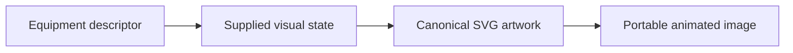

# Growing & aquaculture

[Parent map](../README.md) · [Gallery](../../README.md) · [Package owner](../../../README.md) · [Interactive equipment example](../../../examples/components/index.html)

Generated from the library renderer. These images show supplied illustrative visual state; they do not run a system model. Motion follows the image viewer’s reduced-motion preference where supported. Static renderers retain the equipment and readouts.

This folder contains **10 previews**. Open an image for its full size; use the interactive example to change fields. The table lists the rendering inputs for each asset. Regenerate this map with `npm run gallery:generate`; do not edit generated SVGs or indexes.

| Preview | Equipment and supplied state |
| --- | --- |
|  | **Aquaculture fish tank** `fish-tank` Active illustrative preview  Aquatic vessel with visible inventory, independent aeration and decorative fish silhouettes.  Editable fields: `active`, `running`, `fault`, `status`, `level`, `oxygen`, `load`, `damage`. |
|  | **Biological media filter** `biofilter` Active illustrative preview  Visible biomedia vessel with separately supplied water and air.  Editable fields: `active`, `running`, `fault`, `status`, `level`, `oxygen`, `load`, `damage`. |
|  | **Media grow bed** `media-grow-bed` Active illustrative preview  Granular root bed with an externally supplied flood/drain phase.  Editable fields: `active`, `running`, `fault`, `status`, `level`, `moisture`, `phase`, `damage`. |
|  | **Deep-water raft bed** `dwc-raft-bed` Active illustrative preview  Floating plant raft above a separate water and aeration volume.  Editable fields: `active`, `running`, `fault`, `status`, `level`, `oxygen`, `load`, `damage`. |
|  | **Nutrient-film channel** `nft-channel` Active illustrative preview  Shallow solution channel with exposed root positions and gravity return.  Editable fields: `active`, `running`, `fault`, `status`, `moisture`, `load`, `damage`. |
|  | **Ebb-and-flow nursery table** `ebb-flow-table` Active illustrative preview  Raised nursery tray with fill, hold and drain phases controlled by the host.  Editable fields: `active`, `running`, `fault`, `status`, `level`, `moisture`, `phase`, `damage`. |
|  | **Drip irrigation zone** `drip-zone` Active illustrative preview  Emitter manifold above substrate pots with a separately visible collection drain.  Editable fields: `active`, `running`, `fault`, `status`, `moisture`, `load`, `damage`. |
|  | **Aeroponic root chamber** `aeroponic-chamber` Active illustrative preview  Enclosed roots supplied by an explicit mist manifold and drain.  Editable fields: `active`, `running`, `fault`, `status`, `moisture`, `load`, `damage`. |
|  | **Horticultural light panel** `grow-light` Active illustrative preview  Downward-facing light array with electrical input, emitted light and rejected heat.  Editable fields: `active`, `running`, `fault`, `status`, `light`, `load`, `damage`. |
|  | **Submerged air diffuser** `air-diffuser` Active illustrative preview  Porous diffuser and restrained bubble plume driven by supplied air.  Editable fields: `active`, `running`, `fault`, `status`, `airflow`, `oxygen`, `damage`. |
