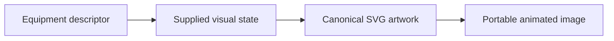

# PLC & networks

[Parent map](../README.md) · [Gallery](../../README.md) · [Package owner](../../../README.md) · [Interactive equipment example](../../../examples/components/index.html)

Generated from the library renderer. These images show supplied illustrative visual state; they do not run a system model. Motion follows the image viewer’s reduced-motion preference where supported. Static renderers retain the equipment and readouts.

This folder contains **7 previews**. Open an image for its full size; use the interactive example to change fields. The table lists the rendering inputs for each asset. Regenerate this map with `npm run gallery:generate`; do not edit generated SVGs or indexes.

| Preview | Equipment and supplied state |
| --- | --- |
|  | **PLC rack** `plc-rack` Active illustrative preview  Power supply, CPU and modular IO on a common backplane.  Editable fields: `active`, `running`, `fault`, `status`, `connected`, `load`, `damage`. |
|  | **PLC CPU** `plc-cpu` Active illustrative preview  Controller module with mode indicators, scan status and service port.  Editable fields: `active`, `running`, `fault`, `status`, `connected`, `load`, `damage`. |
|  | **Remote IO station** `remote-io` Active illustrative preview  Distributed input and output modules with field terminal blocks.  Editable fields: `active`, `running`, `fault`, `status`, `connected`, `load`, `damage`. |
|  | **Operator HMI** `hmi` Active illustrative preview  Panel-mounted touch display with a miniature process diagram.  Editable fields: `active`, `running`, `fault`, `status`, `connected`, `damage`. |
|  | **SCADA server** `scada-server` Active illustrative preview  Server enclosure with drive bays, trend display and network activity.  Editable fields: `active`, `running`, `fault`, `status`, `connected`, `load`, `damage`. |
|  | **Industrial network switch** `network-switch` Active illustrative preview  Rugged Ethernet switch with individual RJ45 ports and link activity.  Editable fields: `active`, `running`, `fault`, `status`, `connected`, `load`, `damage`. |
|  | **Telemetry radio** `radio` Active illustrative preview  Antenna, radio enclosure and pulsing bidirectional signal arcs.  Editable fields: `active`, `running`, `fault`, `status`, `connected`, `damage`. |
