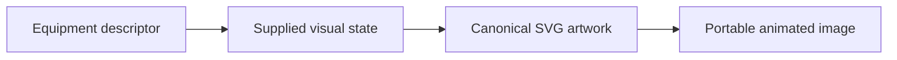

# Climate control

[Parent map](../README.md) · [Gallery](../../README.md) · [Package owner](../../../README.md) · [Interactive equipment example](../../../examples/components/index.html)

Generated from the library renderer. These images show supplied illustrative visual state; they do not run a system model. Motion follows the image viewer’s reduced-motion preference where supported. Static renderers retain the equipment and readouts.

This folder contains **4 previews**. Open an image for its full size; use the interactive example to change fields. The table lists the rendering inputs for each asset. Regenerate this map with `npm run gallery:generate`; do not edit generated SVGs or indexes.

| Preview | Equipment and supplied state |
| --- | --- |
|  | **Greenhouse vent** `greenhouse-vent` Active illustrative preview  Hinged roof vent with explicit position and an independent air path.  Editable fields: `active`, `running`, `fault`, `status`, `opening`, `airflow`, `damage`. |
|  | **Retractable shade screen** `shade-screen` Active illustrative preview  Retracting mesh screen with visible deployment and separate incident/transmitted light.  Editable fields: `active`, `running`, `fault`, `status`, `opening`, `light`, `damage`. |
|  | **Evaporative cooling pad** `evaporative-pad` Active illustrative preview  Wetted pad with distinct air passage and recirculating water connections.  Editable fields: `active`, `running`, `fault`, `status`, `moisture`, `airflow`, `humidity`, `damage`. |
|  | **Air dehumidifier** `dehumidifier` Active illustrative preview  Air coil enclosure with fan, condensate collector and separate drain.  Editable fields: `active`, `running`, `fault`, `status`, `humidity`, `level`, `load`, `damage`. |
