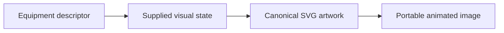

# Connections

[Parent map](../README.md) · [Gallery](../../README.md) · [Package owner](../../../README.md) · [Interactive equipment example](../../../examples/components/index.html)

Generated from the library renderer. These images show supplied illustrative visual state; they do not run a system model. Motion follows the image viewer’s reduced-motion preference where supported. Static renderers retain the equipment and readouts.

This folder contains **10 previews**. Open an image for its full size; use the interactive example to change fields. The table lists the rendering inputs for each asset. Regenerate this map with `npm run gallery:generate`; do not edit generated SVGs or indexes.

| Preview | Equipment and supplied state |
| --- | --- |
|  | **Process pipe** `pipe` Active illustrative preview  Elbow pipe segment with animated flow and flange details.  Editable fields: `active`, `running`, `fault`, `status`, `open`, `damage`. |
|  | **Process pipe — Water service** `pipe` / `water` Active illustrative preview  Explicit illustrative compatibility selection; engineering service suitability is not established.  Editable fields: `active`, `running`, `fault`, `status`, `open`, `damage`. |
|  | **Process pipe — Heat-transfer fluid** `pipe` / `thermal-fluid` Active illustrative preview  Explicit illustrative compatibility selection; engineering service suitability is not established.  Editable fields: `active`, `running`, `fault`, `status`, `open`, `damage`. |
|  | **Process pipe — Helium circulation** `pipe` / `helium` Active illustrative preview  Explicit illustrative compatibility selection; engineering service suitability is not established.  Editable fields: `active`, `running`, `fault`, `status`, `open`, `damage`. |
|  | **Process pipe — Sodium loop concept** `pipe` / `sodium` Active illustrative preview  Explicit illustrative compatibility selection; engineering service suitability is not established.  Editable fields: `active`, `running`, `fault`, `status`, `open`, `damage`. |
|  | **Process pipe — Salt loop concept** `pipe` / `salt` Active illustrative preview  Explicit illustrative compatibility selection; engineering service suitability is not established.  Editable fields: `active`, `running`, `fault`, `status`, `open`, `damage`. |
|  | **Process pipe — Heavy-water loop concept** `pipe` / `heavy-water` Active illustrative preview  Explicit illustrative compatibility selection; engineering service suitability is not established.  Editable fields: `active`, `running`, `fault`, `status`, `open`, `damage`. |
|  | **Process pipe — Organic working-fluid loop** `pipe` / `organic-working-fluid` Active illustrative preview  Explicit illustrative compatibility selection; engineering service suitability is not established.  Editable fields: `active`, `running`, `fault`, `status`, `open`, `damage`. |
|  | **Process pipe — Liquid-fuel transfer** `pipe` / `liquid-fuel` Active illustrative preview  Explicit illustrative compatibility selection; engineering service suitability is not established.  Editable fields: `active`, `running`, `fault`, `status`, `open`, `damage`. |
|  | **Four-way junction** `junction` Active illustrative preview  Four process branches meeting at an explicitly marked common junction.  Editable fields: `active`, `running`, `fault`, `status`, `open`, `damage`. |
