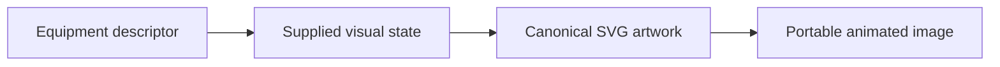

# Instruments

[Parent map](../README.md) · [Gallery](../../README.md) · [Package owner](../../../README.md) · [Interactive equipment example](../../../examples/components/index.html)

Generated from the library renderer. These images show supplied illustrative visual state; they do not run a system model. Motion follows the image viewer’s reduced-motion preference where supported. Static renderers retain the equipment and readouts.

This folder contains **8 previews**. Open an image for its full size; use the interactive example to change fields. The table lists the rendering inputs for each asset. Regenerate this map with `npm run gallery:generate`; do not edit generated SVGs or indexes.

| Preview | Equipment and supplied state |
| --- | --- |
|  | **Pressure transmitter** `pressure-transmitter` Active illustrative preview  Round pressure dial with a sensing stem, needle and signal halo.  Editable fields: `active`, `running`, `fault`, `status`, `value`, `damage`. |
|  | **Inline flow meter** `flow-meter` Active illustrative preview  Flanged spool, digital display and animated direction markers.  Editable fields: `active`, `running`, `fault`, `status`, `value`, `damage`. |
|  | **Temperature probe** `temperature-sensor` Active illustrative preview  Thermowell probe with a temperature bulb and local transmitter head.  Editable fields: `active`, `running`, `fault`, `status`, `value`, `damage`. |
|  | **Level transmitter** `level-sensor` Active illustrative preview  Radar head with a downward sensing cone and vertical fill ruler.  Editable fields: `active`, `running`, `fault`, `status`, `level`, `value`, `damage`. |
|  | **Gas analyzer** `gas-analyzer` Active illustrative preview  Sampling cabinet with gas tubing, spectrum trace and local display.  Editable fields: `active`, `running`, `fault`, `status`, `value`, `damage`. |
|  | **Water-quality probe** `water-quality-probe` Active illustrative preview  Immersed probe with explicit pH, EC or dissolved-oxygen identity; readings remain illustrative indices.  Editable fields: `active`, `running`, `fault`, `status`, `connected`, `measurement`, `value`, `damage`. |
|  | **Humidity sensor** `humidity-sensor` Active illustrative preview  Ventilated sensing enclosure with a humidity identity and external reading.  Editable fields: `active`, `running`, `fault`, `status`, `connected`, `humidity`, `damage`. |
|  | **PAR light sensor** `light-sensor` Active illustrative preview  Quantum-sensor silhouette with a light identity; no conversion to physical PAR is inferred.  Editable fields: `active`, `running`, `fault`, `status`, `connected`, `light`, `damage`. |
