# Instruments

[Parent map](../README.md) · [Package owner](../../../README.md) · [Image gallery](../../README.md)

Generated previews from canonical equipment artwork and supplied illustrative state. Images do not run a process model. Open a preview for its full size.

| Folder | Previews | Example |
| --- | ---: | --- |
| [Inline flow meter](flow-meter/README.md) | 1 |  |
| [Gas analyzer](gas-analyzer/README.md) | 1 |  |
| [Humidity sensor](humidity-sensor/README.md) | 1 |  |
| [Level transmitter](level-sensor/README.md) | 1 |  |
| [PAR light sensor](light-sensor/README.md) | 1 |  |
| [Pressure transmitter](pressure-transmitter/README.md) | 1 |  |
| [Temperature probe](temperature-sensor/README.md) | 1 |  |
| [Water-quality probe](water-quality-probe/README.md) | 1 |  |
