# Manufacturing & solids

[Parent map](../README.md) · [Gallery](../../README.md) · [Package owner](../../../README.md) · [Interactive equipment example](../../../examples/components/index.html)

Generated from the library renderer. These images show supplied illustrative visual state; they do not run a system model. Motion follows the image viewer’s reduced-motion preference where supported. Static renderers retain the equipment and readouts.

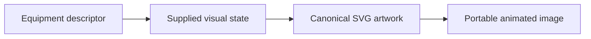

This folder contains **18 previews**. Open an image for its full size; use the interactive example to change fields. The table lists the rendering inputs for each asset. Regenerate this map with `npm run gallery:generate`; do not edit generated SVGs or indexes.

| Preview | Equipment and supplied state |
| --- | --- |
| <a href="conveyor.svg"></a> | **Belt conveyor** `conveyor` Active illustrative preview  Powered material belt with support rollers, travelling product and a distinct jam state.  Editable fields: `active`, `running`, `fault`, `status`, `load`, `speed`, `damage`. |
|  | **Jaw crusher** `crusher` Active illustrative preview  Feed hopper, crushing jaws and material discharge with wear and blockage detail.  Editable fields: `active`, `running`, `fault`, `status`, `load`, `speed`, `damage`. |
| <a href="vibrating-screen.svg"></a> | **Vibrating screen** `vibrating-screen` Active illustrative preview  Multi-deck separation screen with visible feed, vibration and screened output.  Editable fields: `active`, `running`, `fault`, `status`, `load`, `speed`, `damage`. |
| <a href="grinding-mill.svg"></a> | **Grinding mill** `grinding-mill` Active illustrative preview  Rotating grinding chamber and a separate drive, with worn liner and overheating states.  Editable fields: `active`, `running`, `fault`, `status`, `load`, `speed`, `damage`. |
|  | **Rotary kiln** `rotary-kiln` Active illustrative preview  Long heated rotating drum with burner, support tyres and refractory-damage detail.  Editable fields: `active`, `running`, `fault`, `status`, `load`, `speed`, `temperature`, `damage`. |
| <a href="oven.svg"></a> | **Conveyor oven** `oven` Active illustrative preview  Cutaway heating tunnel with upper and lower heating coils, a moving metal belt and traveling product trays.  Editable fields: `active`, `running`, `fault`, `status`, `load`, `temperature`, `damage`. |
|  | **Rack / batch oven** `rack-oven` Active illustrative preview  Front-loading electric batch oven with stationary product shelves, a hinged inspection door, recirculating air and retained thermal glow.  Editable fields: `active`, `running`, `fault`, `status`, `load`, `temperature`, `open`, `damage`. |
| <a href="dryer.svg"></a> | **Rotary dryer** `dryer` Active illustrative preview  Heated tumbling drum with vapor discharge and drying-load illustration.  Editable fields: `active`, `running`, `fault`, `status`, `load`, `speed`, `temperature`, `damage`. |
|  | **Screw extruder** `extruder` Active illustrative preview  Heated barrel and screw drive that advance feed into a formed product.  Editable fields: `active`, `running`, `fault`, `status`, `load`, `speed`, `damage`. |
|  | **Tablet press** `tablet-press` Active illustrative preview  Rotary turret, compression tooling and tablet discharge with an explicit jam state.  Editable fields: `active`, `running`, `fault`, `status`, `load`, `speed`, `damage`. |
|  | **Filling line** `filling-line` Active illustrative preview  Metered filling heads and a moving line of containers.  Editable fields: `active`, `running`, `fault`, `status`, `load`, `speed`, `damage`. |
| <a href="packaging-line.svg"></a> | **Packaging line** `packaging-line` Active illustrative preview  Product conveyor, wrapping station and sealed packages.  Editable fields: `active`, `running`, `fault`, `status`, `load`, `speed`, `damage`. |
| <a href="granulator.svg"></a> | **Granulator** `granulator` Active illustrative preview  Granulating rotor and screened outlet for particle-size processing.  Editable fields: `active`, `running`, `fault`, `status`, `load`, `speed`, `damage`. |
|  | **Forming machine** `forming-machine` Active illustrative preview  Tooling station with a controlled forming stroke and product outfeed.  Editable fields: `active`, `running`, `fault`, `status`, `load`, `speed`, `damage`. |
| <a href="drum-mixer.svg"></a> | **Drum mixer** `drum-mixer` Active illustrative preview  Rotating mixing drum with inlet and discharge for bulk blending.  Editable fields: `active`, `running`, `fault`, `status`, `load`, `speed`, `damage`. |
| <a href="paper-machine.svg"></a> | **Paper machine** `paper-machine` Active illustrative preview  Stock feed, forming belt and drying rollers leading to a paper reel.  Editable fields: `active`, `running`, `fault`, `status`, `load`, `speed`, `damage`. |
| <a href="weigh-hopper.svg"></a> | **Weigh hopper** `weigh-hopper` Active illustrative preview  Weighing hopper, support load cells and a controlled solids discharge.  Editable fields: `active`, `running`, `fault`, `status`, `level`, `load`, `damage`. |
| <a href="screw-feeder.svg"></a> | **Screw feeder** `screw-feeder` Active illustrative preview  Enclosed screw transport with a visible helix, intake and metered discharge.  Editable fields: `active`, `running`, `fault`, `status`, `load`, `speed`, `damage`. |
