# Manufacturing & solids

[Parent map](../README.md) · [Package owner](../../../README.md) · [Image gallery](../../README.md)

Generated previews from canonical equipment artwork and supplied illustrative state. Images do not run a process model. Open a preview for its full size.

| Folder | Previews | Example |
| --- | ---: | --- |
| [Belt conveyor](conveyor/README.md) | 1 |  |
| [Jaw crusher](crusher/README.md) | 1 |  |
| [Drum mixer](drum-mixer/README.md) | 1 |  |
| [Rotary dryer](dryer/README.md) | 1 |  |
| [Screw extruder](extruder/README.md) | 1 |  |
| [Filling line](filling-line/README.md) | 1 |  |
| [Forming machine](forming-machine/README.md) | 1 |  |
| [Granulator](granulator/README.md) | 1 |  |
| [Grinding mill](grinding-mill/README.md) | 1 |  |
| [Conveyor oven](oven/README.md) | 1 |  |
| [Packaging line](packaging-line/README.md) | 1 |  |
| [Paper machine](paper-machine/README.md) | 1 |  |
| [Rack / batch oven](rack-oven/README.md) | 1 |  |
| [Rotary kiln](rotary-kiln/README.md) | 1 |  |
| [Screw feeder](screw-feeder/README.md) | 1 |  |
| [Tablet press](tablet-press/README.md) | 1 |  |
| [Vibrating screen](vibrating-screen/README.md) | 1 |  |
| [Weigh hopper](weigh-hopper/README.md) | 1 |  |
