# Nuclear systems

[Parent map](../README.md) · [Gallery](../../README.md) · [Package owner](../../../README.md) · [Interactive equipment example](../../../examples/components/index.html)

Generated from the library renderer. These images show supplied illustrative visual state; they do not run a system model. Motion follows the image viewer’s reduced-motion preference where supported. Static renderers retain the equipment and readouts.

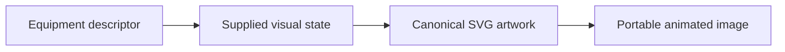

This folder contains **19 previews**. Open an image for its full size; use the interactive example to change fields. The table lists the rendering inputs for each asset. Regenerate this map with `npm run gallery:generate`; do not edit generated SVGs or indexes.

| Preview | Equipment and supplied state |
| --- | --- |
| <a href="pwr-reactor-vessel.svg"></a> | **Pressurized-water reactor vessel** `pwr-reactor-vessel` Active illustrative preview  Conceptual water-cooled vessel with supplied inventory, circulation, rod insertion and residual thermal state.  Editable fields: `active`, `running`, `fault`, `status`, `load`, `heat`, `flow`, `level`, `rodPosition`, `damage`. |
| <a href="bwr-reactor-vessel.svg"></a> | **Boiling-water reactor vessel** `bwr-reactor-vessel` Active illustrative preview  Conceptual vessel with internal steam separation and a direct steam outlet rather than a PWR secondary generator.  Editable fields: `active`, `running`, `fault`, `status`, `load`, `heat`, `flow`, `level`, `rodPosition`, `damage`. |
| <a href="phwr-calandria.svg"></a> | **PHWR calandria and pressure channels** `phwr-calandria` Active illustrative preview  Horizontal pressure channels and moderator inventory; heat-transport and moderator circuits remain separate.  Editable fields: `active`, `running`, `fault`, `status`, `load`, `heat`, `flow`, `level`, `rodPosition`, `damage`. |
| <a href="gas-cooled-reactor.svg"></a> | **Gas-cooled reactor concept** `gas-cooled-reactor` Active illustrative preview  Graphite-core and helium-circulation presentation with independent residual thermal indication.  Editable fields: `active`, `running`, `fault`, `status`, `load`, `heat`, `flow`, `rodPosition`, `damage`. |
| <a href="sodium-reactor-vessel.svg"></a> | **Sodium-cooled reactor concept** `sodium-reactor-vessel` Active illustrative preview  Liquid-metal inventory and core presentation; an intermediate heat exchanger is a separately authored asset.  Editable fields: `active`, `running`, `fault`, `status`, `load`, `heat`, `flow`, `level`, `rodPosition`, `damage`. |
| <a href="molten-salt-reactor.svg"></a> | **Molten-salt reactor concept** `molten-salt-reactor` Active illustrative preview  Selected solid-fuel, salt-cooled loop concept. Liquid-fuel salt arrangements require a separate future contract; no neutronics are implied.  Editable fields: `active`, `running`, `fault`, `status`, `load`, `heat`, `flow`, `level`, `rodPosition`, `damage`. |
| <a href="molten-salt-reactor--solid-fuel-salt-cooled.svg"></a> | **Molten-salt reactor concept — Solid fuel / salt coolant** `molten-salt-reactor` / `solid-fuel-salt-cooled` Active illustrative preview  Selected solid-fuel, salt-cooled loop concept. Liquid-fuel salt arrangements require a separate future contract; no neutronics are implied.  Editable fields: `active`, `running`, `fault`, `status`, `load`, `heat`, `flow`, `level`, `rodPosition`, `damage`. |
| <a href="nuclear-steam-generator.svg"></a> | **Nuclear steam generator** `nuclear-steam-generator` Active illustrative preview  Primary tube loop and isolated secondary water/steam inventory with independently supplied flow indicators.  Editable fields: `active`, `running`, `fault`, `status`, `primaryFlow`, `secondaryFlow`, `level`, `heat`, `damage`. |
| <a href="nuclear-steam-generator--water-primary.svg"></a> | **Nuclear steam generator — Water primary** `nuclear-steam-generator` / `water-primary` Active illustrative preview  Primary tube loop and isolated secondary water/steam inventory with independently supplied flow indicators.  Editable fields: `active`, `running`, `fault`, `status`, `primaryFlow`, `secondaryFlow`, `level`, `heat`, `damage`. |
|  | **Nuclear steam generator — Heavy-water primary** `nuclear-steam-generator` / `heavy-water-primary` Active illustrative preview  Primary tube loop and isolated secondary water/steam inventory with independently supplied flow indicators.  Editable fields: `active`, `running`, `fault`, `status`, `primaryFlow`, `secondaryFlow`, `level`, `heat`, `damage`. |
|  | **Nuclear steam generator — Helium primary** `nuclear-steam-generator` / `helium-primary` Active illustrative preview  Primary tube loop and isolated secondary water/steam inventory with independently supplied flow indicators.  Editable fields: `active`, `running`, `fault`, `status`, `primaryFlow`, `secondaryFlow`, `level`, `heat`, `damage`. |
| <a href="nuclear-steam-generator--sodium-primary.svg"></a> | **Nuclear steam generator — Sodium intermediate loop** `nuclear-steam-generator` / `sodium-primary` Active illustrative preview  Primary tube loop and isolated secondary water/steam inventory with independently supplied flow indicators.  Editable fields: `active`, `running`, `fault`, `status`, `primaryFlow`, `secondaryFlow`, `level`, `heat`, `damage`. |
| <a href="nuclear-steam-generator--salt-primary.svg"></a> | **Nuclear steam generator — Salt intermediate loop** `nuclear-steam-generator` / `salt-primary` Active illustrative preview  Primary tube loop and isolated secondary water/steam inventory with independently supplied flow indicators.  Editable fields: `active`, `running`, `fault`, `status`, `primaryFlow`, `secondaryFlow`, `level`, `heat`, `damage`. |
| <a href="pressurizer.svg"></a> | **Pressurizer** `pressurizer` Active illustrative preview  Conceptual surge vessel, heater and spray with an explicitly fictional pressure index.  Editable fields: `active`, `running`, `fault`, `status`, `level`, `heat`, `pressure`, `damage`. |
| <a href="containment-structure.svg"></a> | **Containment structure** `containment-structure` Active illustrative preview  Conceptual enclosure with independent integrity, atmosphere and residual thermal indications.  Editable fields: `active`, `running`, `fault`, `status`, `pressure`, `integrity`, `flow`, `heat`, `damage`. |
| <a href="used-fuel-pool.svg"></a> | **Used-fuel cooling pool** `used-fuel-pool` Active illustrative preview  Rack inventory under water with supplied cooling flow and retained heat, separate from a reactor vessel.  Editable fields: `active`, `running`, `fault`, `status`, `level`, `flow`, `heat`, `damage`. |
| <a href="control-rod-drive.svg"></a> | **Control-rod drive indicator** `control-rod-drive` Active illustrative preview  Supplied insertion position and drive availability; hold state does not continuously cycle the rods.  Editable fields: `active`, `running`, `fault`, `status`, `rodPosition`, `speed`, `moving`, `damage`. |
| <a href="neutron-monitor.svg"></a> | **Neutron monitor concept** `neutron-monitor` Active illustrative preview  Detector channel and fictional signal index; unavailable signals render as unavailable rather than a valid number.  Editable fields: `active`, `running`, `fault`, `status`, `value`, `connected`, `damage`. |
| <a href="radiation-monitor.svg"></a> | **Radiation monitor concept** `radiation-monitor` Active illustrative preview  Area-monitor enclosure and fictional index with no radiation dose or activity calibration.  Editable fields: `active`, `running`, `fault`, `status`, `value`, `connected`, `damage`. |
