# Molten-salt reactor concept

[Parent map](../README.md) · [Package owner](../../../../README.md) · [Image gallery](../../../README.md)

Generated previews from canonical equipment artwork and supplied illustrative state. Images do not run a process model. Open a preview for its full size.

| File | Preview | Equipment and supplied state |
| --- | --- | --- |
| [default.svg](default.svg) |  | Molten-salt reactor concept Active illustrative preview `molten-salt-reactor` Editable fields: `active`, `running`, `fault`, `status`, `load`, `heat`, `flow`, `level`, `rodPosition`, `damage` |
| [solid-fuel-salt-cooled.svg](solid-fuel-salt-cooled.svg) |  | Molten-salt reactor concept — Solid fuel / salt coolant Active illustrative preview `molten-salt-reactor` / `solid-fuel-salt-cooled` Editable fields: `active`, `running`, `fault`, `status`, `load`, `heat`, `flow`, `level`, `rodPosition`, `damage` |
