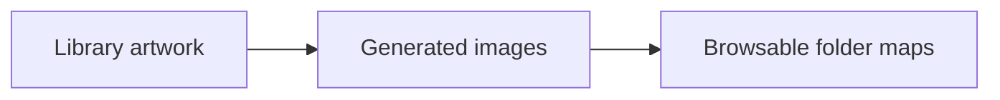

# Nuclear steam generator

[Parent map](../README.md) · [Package owner](../../../../README.md) · [Image gallery](../../../README.md)

Generated previews from canonical equipment artwork and supplied illustrative state. Images do not run a process model. Open a preview for its full size.

| File | Preview | Equipment and supplied state |
| --- | --- | --- |
| [default.svg](default.svg) |  | Nuclear steam generator Active illustrative preview `nuclear-steam-generator` Editable fields: `active`, `running`, `fault`, `status`, `primaryFlow`, `secondaryFlow`, `level`, `heat`, `damage` |
| [water-primary.svg](water-primary.svg) |  | Nuclear steam generator — Water primary Active illustrative preview `nuclear-steam-generator` / `water-primary` Editable fields: `active`, `running`, `fault`, `status`, `primaryFlow`, `secondaryFlow`, `level`, `heat`, `damage` |
| [heavy-water-primary.svg](heavy-water-primary.svg) |  | Nuclear steam generator — Heavy-water primary Active illustrative preview `nuclear-steam-generator` / `heavy-water-primary` Editable fields: `active`, `running`, `fault`, `status`, `primaryFlow`, `secondaryFlow`, `level`, `heat`, `damage` |
| [helium-primary.svg](helium-primary.svg) |  | Nuclear steam generator — Helium primary Active illustrative preview `nuclear-steam-generator` / `helium-primary` Editable fields: `active`, `running`, `fault`, `status`, `primaryFlow`, `secondaryFlow`, `level`, `heat`, `damage` |
| [sodium-primary.svg](sodium-primary.svg) |  | Nuclear steam generator — Sodium intermediate loop Active illustrative preview `nuclear-steam-generator` / `sodium-primary` Editable fields: `active`, `running`, `fault`, `status`, `primaryFlow`, `secondaryFlow`, `level`, `heat`, `damage` |
| [salt-primary.svg](salt-primary.svg) |  | Nuclear steam generator — Salt intermediate loop Active illustrative preview `nuclear-steam-generator` / `salt-primary` Editable fields: `active`, `running`, `fault`, `status`, `primaryFlow`, `secondaryFlow`, `level`, `heat`, `damage` |
