# Power & energy

[Parent map](../README.md) · [Gallery](../../README.md) · [Package owner](../../../README.md) · [Interactive equipment example](../../../examples/components/index.html)

Generated from the library renderer. These images show supplied illustrative visual state; they do not run a system model. Motion follows the image viewer’s reduced-motion preference where supported. Static renderers retain the equipment and readouts.

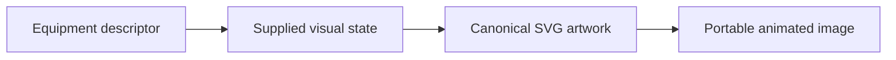

This folder contains **55 previews**. Open an image for its full size; use the interactive example to change fields. The table lists the rendering inputs for each asset. Regenerate this map with `npm run gallery:generate`; do not edit generated SVGs or indexes.

| Preview | Equipment and supplied state |
| --- | --- |
| <a href="generator.svg"></a> | **Microturbine generator** `generator` Active illustrative preview  Shared louvered generator cabinet with exhaust and electrical output lead.  Editable fields: `active`, `running`, `fault`, `status`, `load`, `speed`, `damage`. |
| <a href="generator--natural-gas-enclosed.svg"></a> | **Natural-gas generator cabinet — Natural gas / enclosed** `generator` / `natural-gas-enclosed` Active illustrative preview  Original cabinet packaged-generator illustration with an explicit natural gas inlet. Capacity and dynamics come from the external model.  Editable fields: `active`, `running`, `fault`, `status`, `load`, `speed`, `damage`. |
| <a href="generator--natural-gas-industrial.svg"></a> | **Natural-gas generator skid — Natural gas / industrial skid** `generator` / `natural-gas-industrial` Active illustrative preview  Original skid packaged-generator illustration with an explicit natural gas inlet. Capacity and dynamics come from the external model.  Editable fields: `active`, `running`, `fault`, `status`, `load`, `speed`, `damage`. |
| <a href="generator--diesel-skid.svg"></a> | **Diesel generator skid — Diesel / skid** `generator` / `diesel-skid` Active illustrative preview  Original skid packaged-generator illustration with an explicit diesel inlet. Capacity and dynamics come from the external model.  Editable fields: `active`, `running`, `fault`, `status`, `load`, `speed`, `damage`. |
| <a href="generator--diesel-enclosed.svg"></a> | **Diesel generator cabinet — Diesel / enclosed** `generator` / `diesel-enclosed` Active illustrative preview  Original cabinet packaged-generator illustration with an explicit diesel inlet. Capacity and dynamics come from the external model.  Editable fields: `active`, `running`, `fault`, `status`, `load`, `speed`, `damage`. |
| <a href="generator--gasoline-portable.svg"></a> | **Gasoline generator portable frame — Gasoline / portable** `generator` / `gasoline-portable` Active illustrative preview  Original portable frame packaged-generator illustration with an explicit gasoline inlet. Capacity and dynamics come from the external model.  Editable fields: `active`, `running`, `fault`, `status`, `load`, `speed`, `damage`. |
| <a href="transformer.svg"></a> | **Power transformer** `transformer` Active illustrative preview  Finned transformer tank with primary and secondary bushings.  Editable fields: `active`, `running`, `fault`, `status`, `load`, `damage`. |
| <a href="breaker.svg"></a> | **Circuit breaker** `breaker` Active illustrative preview  Contact enclosure with an explicit open or closed electrical path.  Editable fields: `active`, `running`, `fault`, `status`, `open`, `damage`. |
| <a href="busbar.svg"></a> | **Distribution bus** `busbar` Active illustrative preview  Three insulated copper rails and visible branch takeoffs.  Editable fields: `active`, `running`, `fault`, `status`, `load`, `damage`. |
| <a href="busbar--bidirectional.svg"></a> | **Distribution bus — Bidirectional AC common bus** `busbar` / `bidirectional` Active illustrative preview  A common AC conductor with four bidirectional connections for explicit supply, load and storage branches. The external model determines each branch flow.  Editable fields: `active`, `running`, `fault`, `status`, `load`, `damage`. |
| <a href="battery.svg"></a> | **Battery bank** `battery` Active illustrative preview  Three cells with adjustable charge bars and linked terminals.  Editable fields: `active`, `running`, `fault`, `status`, `level`, `damage`. |
| <a href="ups.svg"></a> | **Uninterruptible supply** `ups` Active illustrative preview  UPS cabinet with inverter display, battery drawer and output cable.  Editable fields: `active`, `running`, `fault`, `status`, `level`, `load`, `damage`. |
| <a href="solar-panel.svg"></a> | **Solar array** `solar-panel` Active illustrative preview  Tilted photovoltaic panel with individual cells and a DC lead.  Editable fields: `active`, `running`, `fault`, `status`, `load`, `damage`. |
| <a href="electrical-meter.svg"></a> | **Net power indicator** `electrical-meter` Active illustrative preview  Shared animated electrical contribution symbol from the plant twin.  Editable fields: `active`, `running`, `fault`, `status`, `load`, `damage`. |
| <a href="electrolyzer.svg"></a> | **Water electrolyzer** `electrolyzer` Active illustrative preview  Electrochemical plate stack converting a modeled water feed and electrical input into gas streams.  Editable fields: `active`, `running`, `fault`, `status`, `load`, `temperature`, `damage`. |
| <a href="fuel-cell.svg"></a> | **Fuel-cell generator** `fuel-cell` Active illustrative preview  Fuel-cell plate stack, electrical output, heat recovery and water discharge.  Editable fields: `active`, `running`, `fault`, `status`, `load`, `temperature`, `damage`. |
| <a href="wind-turbine.svg"></a> | **Wind turbine** `wind-turbine` Active illustrative preview  Three-blade wind rotor, nacelle and tower with visible blade and gearbox conditions.  Editable fields: `active`, `running`, `fault`, `status`, `load`, `speed`, `damage`. |
| <a href="steam-turbine.svg"></a> | **Steam turbine** `steam-turbine` Active illustrative preview  Staged steam casing with a shaft-driven alternator and condensate outlet.  Editable fields: `active`, `running`, `fault`, `status`, `load`, `speed`, `temperature`, `damage`. |
| <a href="gas-turbine.svg"></a> | **Combustion gas turbine** `gas-turbine` Active illustrative preview  Compressor, combustion and turbine sections with an explicit shaft output and exhaust path.  Editable fields: `active`, `running`, `fault`, `status`, `load`, `speed`, `flow`, `heat`, `damage`. |
| <a href="heat-recovery-steam-generator.svg"></a> | **Heat recovery steam generator** `heat-recovery-steam-generator` Active illustrative preview  Exhaust duct and steam-water tube banks, with physically separate primary and secondary flow lanes.  Editable fields: `active`, `running`, `fault`, `status`, `primaryFlow`, `secondaryFlow`, `level`, `heat`, `damage`. |
| <a href="surface-condenser.svg"></a> | **Surface condenser** `surface-condenser` Active illustrative preview  Condensing steam shell, condensate inventory and a separate cooling-water tube circuit.  Editable fields: `active`, `running`, `fault`, `status`, `primaryFlow`, `secondaryFlow`, `level`, `heat`, `damage`. |
| <a href="deaerator.svg"></a> | **Feedwater deaerator** `deaerator` Active illustrative preview  Feedwater storage vessel and spray section with a separate steam supply and vent.  Editable fields: `active`, `running`, `fault`, `status`, `level`, `flow`, `heat`, `damage`. |
| <a href="cooling-radiator.svg"></a> | **Cooling radiator** `cooling-radiator` Active illustrative preview  Finned liquid-cooling assembly and fan, with separate coolant and ambient-air paths.  Editable fields: `active`, `running`, `fault`, `status`, `speed`, `flow`, `heat`, `damage`. |
| <a href="fuel-pressure-regulator.svg"></a> | **Fuel pressure regulator** `fuel-pressure-regulator` Active illustrative preview  Gas regulator body, actuator and pressure indication with continuously supplied opening.  Editable fields: `active`, `running`, `fault`, `status`, `open`, `opening`, `pressure`, `flow`, `damage`. |
| <a href="reservoir.svg"></a> | **Water reservoir** `reservoir` Active illustrative preview  Open water inventory with a shoreline and intake, distinct from a pressure vessel or gas holder.  Editable fields: `active`, `running`, `fault`, `status`, `level`, `flow`, `damage`. |
| <a href="intake-gate.svg"></a> | **Hydraulic intake gate** `intake-gate` Active illustrative preview  Moving gate plate and visible aperture controlling a water intake.  Editable fields: `active`, `running`, `fault`, `status`, `open`, `opening`, `damage`. |
| <a href="hydro-turbine.svg"></a> | **Hydraulic turbine** `hydro-turbine` Active illustrative preview  Water runner and casing with distinct water and mechanical output paths.  Editable fields: `active`, `running`, `fault`, `status`, `speed`, `load`, `flow`, `damage`. |
| <a href="reversible-pump-turbine.svg"></a> | **Reversible pump-turbine** `reversible-pump-turbine` Active illustrative preview  One physical unit with explicit pumping, generating and stopped modes, not simultaneous free production.  Editable fields: `active`, `running`, `fault`, `status`, `speed`, `load`, `flow`, `mode`, `damage`. |
| <a href="power-inverter.svg"></a> | **DC/AC power inverter** `power-inverter` Active illustrative preview  DC/AC conversion cabinet; reverse flow requires the explicit bidirectional variant.  Editable fields: `active`, `running`, `fault`, `status`, `load`, `direction`, `damage`. |
| <a href="power-inverter--dc-to-ac.svg"></a> | **DC/AC power inverter — DC to AC** `power-inverter` / `dc-to-ac` Active illustrative preview  DC/AC conversion cabinet; reverse flow requires the explicit bidirectional variant.  Editable fields: `active`, `running`, `fault`, `status`, `load`, `direction`, `damage`. |
| <a href="power-inverter--bidirectional.svg"></a> | **DC/AC power inverter — Bidirectional converter** `power-inverter` / `bidirectional` Active illustrative preview  DC/AC conversion cabinet; reverse flow requires the explicit bidirectional variant.  Editable fields: `active`, `running`, `fault`, `status`, `load`, `direction`, `damage`. |
| <a href="heliostat.svg"></a> | **Heliostat mirror** `heliostat` Active illustrative preview  Two-axis mirror with a supplied position and independent sunlight resource, separate from PV generation.  Editable fields: `active`, `running`, `fault`, `status`, `position`, `irradiance`, `damage`. |
| <a href="solar-receiver.svg"></a> | **Solar tower receiver** `solar-receiver` Active illustrative preview  Elevated receiver absorbs a separately supplied optical input and heats a circulating fluid.  Editable fields: `active`, `running`, `fault`, `status`, `flow`, `heat`, `damage`. |
| <a href="parabolic-trough.svg"></a> | **Parabolic-trough collector** `parabolic-trough` Active illustrative preview  Curved linear mirror and receiver tube with independent tracking, resource and fluid states.  Editable fields: `active`, `running`, `fault`, `status`, `position`, `irradiance`, `flow`, `heat`, `damage`. |
| <a href="tidal-turbine.svg"></a> | **Tidal-current turbine** `tidal-turbine` Active illustrative preview  Submerged rotor with environmental current distinct from enabled generation.  Editable fields: `active`, `running`, `fault`, `status`, `speed`, `load`, `current`, `direction`, `damage`. |
| <a href="wave-energy-converter.svg"></a> | **Wave point absorber** `wave-energy-converter` Active illustrative preview  Buoy and power-takeoff mechanism; environmental wave movement is independent of the electrical enable flag.  Editable fields: `active`, `running`, `fault`, `status`, `load`, `wave`, `damage`. |
| <a href="alternator.svg"></a> | **Synchronous alternator** `alternator` Active illustrative preview  A shaft-to-electrical machine, distinct from the existing fuelled generator package.  Editable fields: `active`, `running`, `fault`, `status`, `load`, `speed`, `heat`, `field`, `damage`. |
| <a href="alternator--generator.svg"></a> | **Synchronous alternator — Generator** `alternator` / `generator` Active illustrative preview  A shaft-to-electrical machine, distinct from the existing fuelled generator package.  Editable fields: `active`, `running`, `fault`, `status`, `load`, `speed`, `heat`, `field`, `damage`. |
| <a href="alternator--motor-generator.svg"></a> | **Synchronous alternator — Reversible motor-generator** `alternator` / `motor-generator` Active illustrative preview  A shaft-to-electrical machine, distinct from the existing fuelled generator package.  Editable fields: `active`, `running`, `fault`, `status`, `load`, `speed`, `heat`, `field`, `damage`. |
| <a href="hv-circuit-breaker.svg"></a> | **High-voltage circuit breaker** `hv-circuit-breaker` Active illustrative preview  Outdoor interruption poles with visible contact state and a distinct control mechanism.  Editable fields: `active`, `running`, `fault`, `status`, `open`, `load`, `damage`. |
| <a href="disconnect-switch.svg"></a> | **Air-break disconnect switch** `disconnect-switch` Active illustrative preview  Visible isolating blade and insulators, distinct from a circuit breaker interruption chamber.  Editable fields: `active`, `running`, `fault`, `status`, `open`, `load`, `damage`. |
| <a href="disconnect-switch--ac-isolator.svg"></a> | **Air-break disconnect switch — AC isolation** `disconnect-switch` / `ac-isolator` Active illustrative preview  Visible isolating blade and insulators, distinct from a circuit breaker interruption chamber.  Editable fields: `active`, `running`, `fault`, `status`, `open`, `load`, `damage`. |
| <a href="disconnect-switch--dc-isolator.svg"></a> | **Air-break disconnect switch — DC isolation** `disconnect-switch` / `dc-isolator` Active illustrative preview  Visible isolating blade and insulators, distinct from a circuit breaker interruption chamber.  Editable fields: `active`, `running`, `fault`, `status`, `open`, `load`, `damage`. |
| <a href="earthing-switch.svg"></a> | **Earthing switch** `earthing-switch` Active illustrative preview  Grounding blade and earth termination; open means a physically broken ground connection.  Editable fields: `active`, `running`, `fault`, `status`, `open`, `damage`. |
| <a href="current-transformer.svg"></a> | **Current transformer** `current-transformer` Active illustrative preview  Instrument-transformer measurement tap and signal output, not a power-consuming feeder.  Editable fields: `active`, `running`, `fault`, `status`, `value`, `connected`, `damage`. |
| <a href="voltage-transformer.svg"></a> | **Voltage transformer** `voltage-transformer` Active illustrative preview  Voltage-sensing instrument transformer with a separate low-energy observation output.  Editable fields: `active`, `running`, `fault`, `status`, `value`, `connected`, `damage`. |
| <a href="surge-arrester.svg"></a> | **Surge arrester** `surge-arrester` Active illustrative preview  Insulated arrester column and earth lead with supplied stress and degradation indications.  Editable fields: `active`, `running`, `fault`, `status`, `stress`, `damage`. |
| <a href="capacitor-bank.svg"></a> | **Switched capacitor bank** `capacitor-bank` Active illustrative preview  Four visible capacitor groups and switching state with illustrative reactive-support activity.  Editable fields: `active`, `running`, `fault`, `status`, `open`, `load`, `steps`, `damage`. |
| <a href="shunt-reactor.svg"></a> | **Shunt reactor** `shunt-reactor` Active illustrative preview  Reactor winding assembly, bus connection and residual thermal state, not a nuclear reactor.  Editable fields: `active`, `running`, `fault`, `status`, `open`, `load`, `heat`, `damage`. |
|  | **Protection relay** `protection-relay` Active illustrative preview  Measurement input, communications and trip output with no implied certified protection curve.  Editable fields: `active`, `running`, `fault`, `status`, `value`, `connected`, `tripped`, `damage`. |
|  | **Metal-clad switchgear panel** `switchgear-panel` Active illustrative preview  Cabinet, visible circuit status and relay compartment with power and control connections kept distinct.  Editable fields: `active`, `running`, `fault`, `status`, `open`, `load`, `connected`, `damage`. |
|  | **Gas-insulated switchgear bay** `gis-bay` Active illustrative preview  Enclosed switchgear modules with a fictional insulating-gas pressure index and contact status.  Editable fields: `active`, `running`, `fault`, `status`, `open`, `load`, `pressure`, `damage`. |
|  | **Automatic transfer switch** `automatic-transfer-switch` Active illustrative preview  Two mutually selected source paths and a common load output; off disconnects both sources.  Editable fields: `active`, `running`, `fault`, `status`, `source`, `load`, `automatic`, `damage`. |
|  | **Generator excitation system** `excitation-system` Active illustrative preview  Power stage and regulator cabinet with a separate DC field output and feedback connection.  Editable fields: `active`, `running`, `fault`, `status`, `load`, `field`, `connected`, `damage`. |
|  | **AC/DC rectifier** `power-rectifier` Active illustrative preview  AC input and DC output conversion cabinet; this contract does not silently allow reverse power.  Editable fields: `active`, `running`, `fault`, `status`, `load`, `direction`, `damage`. |
