# Synchronous alternator

[Parent map](../README.md) · [Package owner](../../../../README.md) · [Image gallery](../../../README.md)

Generated previews from canonical equipment artwork and supplied illustrative state. Images do not run a process model. Open a preview for its full size.

| File | Preview | Equipment and supplied state |
| --- | --- | --- |
| [default.svg](default.svg) |  | Synchronous alternator Active illustrative preview `alternator` Editable fields: `active`, `running`, `fault`, `status`, `load`, `speed`, `heat`, `field`, `damage` |
| [generator.svg](generator.svg) |  | Synchronous alternator — Generator Active illustrative preview `alternator` / `generator` Editable fields: `active`, `running`, `fault`, `status`, `load`, `speed`, `heat`, `field`, `damage` |
| [motor-generator.svg](motor-generator.svg) |  | Synchronous alternator — Reversible motor-generator Active illustrative preview `alternator` / `motor-generator` Editable fields: `active`, `running`, `fault`, `status`, `load`, `speed`, `heat`, `field`, `damage` |
