# Distribution bus

[Parent map](../README.md) · [Package owner](../../../../README.md) · [Image gallery](../../../README.md)

Generated previews from canonical equipment artwork and supplied illustrative state. Images do not run a process model. Open a preview for its full size.

| File | Preview | Equipment and supplied state |
| --- | --- | --- |
| [default.svg](default.svg) |  | Distribution bus Active illustrative preview `busbar` Editable fields: `active`, `running`, `fault`, `status`, `load`, `damage` |
| [bidirectional.svg](bidirectional.svg) |  | Distribution bus — Bidirectional AC common bus Active illustrative preview `busbar` / `bidirectional` Editable fields: `active`, `running`, `fault`, `status`, `load`, `damage` |
