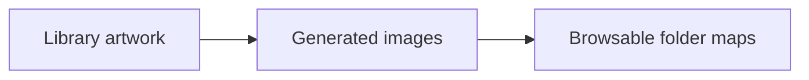

# Air-break disconnect switch

[Parent map](../README.md) · [Package owner](../../../../README.md) · [Image gallery](../../../README.md)

Generated previews from canonical equipment artwork and supplied illustrative state. Images do not run a process model. Open a preview for its full size.

| File | Preview | Equipment and supplied state |
| --- | --- | --- |
| [default.svg](default.svg) |  | Air-break disconnect switch Active illustrative preview `disconnect-switch` Editable fields: `active`, `running`, `fault`, `status`, `open`, `load`, `damage` |
| [ac-isolator.svg](ac-isolator.svg) |  | Air-break disconnect switch — AC isolation Active illustrative preview `disconnect-switch` / `ac-isolator` Editable fields: `active`, `running`, `fault`, `status`, `open`, `load`, `damage` |
| [dc-isolator.svg](dc-isolator.svg) |  | Air-break disconnect switch — DC isolation Active illustrative preview `disconnect-switch` / `dc-isolator` Editable fields: `active`, `running`, `fault`, `status`, `open`, `load`, `damage` |
