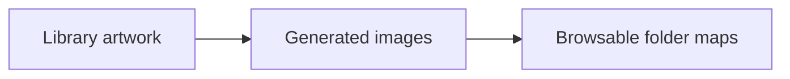

# Microturbine generator

[Parent map](../README.md) · [Package owner](../../../../README.md) · [Image gallery](../../../README.md)

Generated previews from canonical equipment artwork and supplied illustrative state. Images do not run a process model. Open a preview for its full size.

| File | Preview | Equipment and supplied state |
| --- | --- | --- |
| [default.svg](default.svg) |  | Microturbine generator Active illustrative preview `generator` Editable fields: `active`, `running`, `fault`, `status`, `load`, `speed`, `damage` |
| [natural-gas-enclosed.svg](natural-gas-enclosed.svg) |  | Natural-gas generator cabinet — Natural gas / enclosed Active illustrative preview `generator` / `natural-gas-enclosed` Editable fields: `active`, `running`, `fault`, `status`, `load`, `speed`, `damage` |
| [natural-gas-industrial.svg](natural-gas-industrial.svg) |  | Natural-gas generator skid — Natural gas / industrial skid Active illustrative preview `generator` / `natural-gas-industrial` Editable fields: `active`, `running`, `fault`, `status`, `load`, `speed`, `damage` |
| [diesel-skid.svg](diesel-skid.svg) |  | Diesel generator skid — Diesel / skid Active illustrative preview `generator` / `diesel-skid` Editable fields: `active`, `running`, `fault`, `status`, `load`, `speed`, `damage` |
| [diesel-enclosed.svg](diesel-enclosed.svg) |  | Diesel generator cabinet — Diesel / enclosed Active illustrative preview `generator` / `diesel-enclosed` Editable fields: `active`, `running`, `fault`, `status`, `load`, `speed`, `damage` |
| [gasoline-portable.svg](gasoline-portable.svg) |  | Gasoline generator portable frame — Gasoline / portable Active illustrative preview `generator` / `gasoline-portable` Editable fields: `active`, `running`, `fault`, `status`, `load`, `speed`, `damage` |
