# DC/AC power inverter

[Parent map](../README.md) · [Package owner](../../../../README.md) · [Image gallery](../../../README.md)

Generated previews from canonical equipment artwork and supplied illustrative state. Images do not run a process model. Open a preview for its full size.

| File | Preview | Equipment and supplied state |
| --- | --- | --- |
| [default.svg](default.svg) |  | DC/AC power inverter Active illustrative preview `power-inverter` Editable fields: `active`, `running`, `fault`, `status`, `load`, `direction`, `damage` |
| [dc-to-ac.svg](dc-to-ac.svg) |  | DC/AC power inverter — DC to AC Active illustrative preview `power-inverter` / `dc-to-ac` Editable fields: `active`, `running`, `fault`, `status`, `load`, `direction`, `damage` |
| [bidirectional.svg](bidirectional.svg) |  | DC/AC power inverter — Bidirectional converter Active illustrative preview `power-inverter` / `bidirectional` Editable fields: `active`, `running`, `fault`, `status`, `load`, `direction`, `damage` |
