# Process vessels

[Parent map](../README.md) · [Gallery](../../README.md) · [Package owner](../../../README.md) · [Interactive equipment example](../../../examples/components/index.html)

Generated from the library renderer. These images show supplied illustrative visual state; they do not run a system model. Motion follows the image viewer’s reduced-motion preference where supported. Static renderers retain the equipment and readouts.

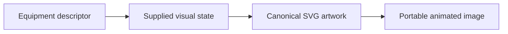

This folder contains **39 previews**. Open an image for its full size; use the interactive example to change fields. The table lists the rendering inputs for each asset. Regenerate this map with `npm run gallery:generate`; do not edit generated SVGs or indexes.

| Preview | Equipment and supplied state |
| --- | --- |
|  | **Anaerobic digester** `digester` Active illustrative preview  Domed vessel with mixing shaft, liquid motion and rising gas bubbles.  Editable fields: `active`, `running`, `fault`, `status`, `level`, `damage`. |
| <a href="tank.svg"></a> | **Storage tank** `tank` Active illustrative preview  Glass-sided cylindrical tank with level scale, inlet and outlet.  Editable fields: `active`, `running`, `fault`, `status`, `level`, `damage`. |
|  | **Gas holder** `gas-holder` Active illustrative preview  Assumed low-pressure gas buffer with an adjustable inventory illustration.  Editable fields: `active`, `running`, `fault`, `status`, `level`, `damage`. |
| <a href="mixing-tank.svg"></a> | **Mixing tank** `mixing-tank` Active illustrative preview  Open vessel, overhead gearbox and an animated agitator.  Editable fields: `active`, `running`, `fault`, `status`, `level`, `damage`. |
| <a href="reactor.svg"></a> | **Pressure reactor** `reactor` Active illustrative preview  Sealed horizontal vessel with inspection flanges and a pressure indicator.  Editable fields: `active`, `running`, `fault`, `status`, `level`, `damage`. |
|  | **Circular clarifier** `clarifier` Active illustrative preview  Settling basin with a moving scraper bridge and central feed well.  Editable fields: `active`, `running`, `fault`, `status`, `level`, `damage`. |
|  | **Bulk solids silo** `silo` Active illustrative preview  Tall storage bin with a conical hopper and discharge throat.  Editable fields: `active`, `running`, `fault`, `status`, `level`, `damage`. |
| <a href="heat-exchanger.svg"></a> | **Heat exchanger** `heat-exchanger` Active illustrative preview  Tube bundle with visually separate hot and cold flow paths.  Editable fields: `active`, `running`, `fault`, `status`, `load`, `temperature`, `damage`. |
| <a href="heat-exchanger--water-water.svg"></a> | **Heat exchanger — Water / water** `heat-exchanger` / `water-water` Active illustrative preview  Tube bundle with visually separate hot and cold flow paths.  Editable fields: `active`, `running`, `fault`, `status`, `load`, `temperature`, `damage`. |
|  | **Heat exchanger — Heavy water / cooling water** `heat-exchanger` / `heavy-water-water` Active illustrative preview  Tube bundle with visually separate hot and cold flow paths.  Editable fields: `active`, `running`, `fault`, `status`, `load`, `temperature`, `damage`. |
|  | **Heat exchanger — Helium / water** `heat-exchanger` / `helium-water` Active illustrative preview  Tube bundle with visually separate hot and cold flow paths.  Editable fields: `active`, `running`, `fault`, `status`, `load`, `temperature`, `damage`. |
|  | **Heat exchanger — Isolated sodium loops** `heat-exchanger` / `sodium-sodium` Active illustrative preview  Tube bundle with visually separate hot and cold flow paths.  Editable fields: `active`, `running`, `fault`, `status`, `load`, `temperature`, `damage`. |
|  | **Heat exchanger — Isolated salt loops** `heat-exchanger` / `salt-salt` Active illustrative preview  Tube bundle with visually separate hot and cold flow paths.  Editable fields: `active`, `running`, `fault`, `status`, `load`, `temperature`, `damage`. |
|  | **Heat exchanger — Salt / water** `heat-exchanger` / `salt-water` Active illustrative preview  Tube bundle with visually separate hot and cold flow paths.  Editable fields: `active`, `running`, `fault`, `status`, `load`, `temperature`, `damage`. |
|  | **Heat exchanger — Thermal fluid / water** `heat-exchanger` / `thermal-fluid-water` Active illustrative preview  Tube bundle with visually separate hot and cold flow paths.  Editable fields: `active`, `running`, `fault`, `status`, `load`, `temperature`, `damage`. |
| <a href="heat-exchanger--geothermal-working-fluid.svg"></a> | **Heat exchanger — Geothermal water / organic working fluid** `heat-exchanger` / `geothermal-working-fluid` Active illustrative preview  Tube bundle with visually separate hot and cold flow paths.  Editable fields: `active`, `running`, `fault`, `status`, `load`, `temperature`, `damage`. |
| <a href="filter.svg"></a> | **Media filter** `filter` Active illustrative preview  Single pressure filter with a porous media bed and differential gauge.  Editable fields: `active`, `running`, `fault`, `status`, `load`, `damage`. |
|  | **Gas treatment train** `gas-treatment` Active illustrative preview  Shared twin illustration for grouped gas conditioning vessels.  Editable fields: `active`, `running`, `fault`, `status`, `load`, `damage`. |
| <a href="boiler.svg"></a> | **Gas-fired boiler** `boiler` Active illustrative preview  Burner window, flame and stack, reused from the twin useful-gas branch.  Editable fields: `active`, `running`, `fault`, `status`, `load`, `temperature`, `damage`. |
|  | **Gas-fired boiler — Gas-fired** `boiler` / `gas-fired` Active illustrative preview  Burner window, flame and stack, reused from the twin useful-gas branch.  Editable fields: `active`, `running`, `fault`, `status`, `load`, `temperature`, `damage`. |
|  | **Solid-fuel boiler — Solid-fuel boiler** `boiler` / `solid-fuel` Active illustrative preview  Generic boiler illustration with an explicit solid-fuel supply, separate combustion-air path and isolated feedwater/steam inventory.  Editable fields: `active`, `running`, `fault`, `status`, `load`, `temperature`, `damage`. |
| <a href="boiler--liquid-fuel.svg"></a> | **Liquid-fuel boiler — Liquid-fuel boiler** `boiler` / `liquid-fuel` Active illustrative preview  Generic boiler illustration with an explicit liquid-fuel supply, separate combustion-air path and isolated feedwater/steam inventory.  Editable fields: `active`, `running`, `fault`, `status`, `load`, `temperature`, `damage`. |
| <a href="flare.svg"></a> | **Flare stack** `flare` Active illustrative preview  Shared controlled-flare illustration with layered flame and embers.  Editable fields: `active`, `running`, `fault`, `status`, `load`, `damage`. |
|  | **Industrial centrifuge** `centrifuge` Active illustrative preview  Horizontal separation bowl, high-speed rotor and distinct liquid and solids outlets.  Editable fields: `active`, `running`, `fault`, `status`, `load`, `speed`, `damage`. |
| <a href="flotation-cell.svg"></a> | **Flotation cell** `flotation-cell` Active illustrative preview  Agitated separation cell with rising air bubbles and a mineral froth layer.  Editable fields: `active`, `running`, `fault`, `status`, `level`, `load`, `speed`, `damage`. |
| <a href="membrane-filter.svg"></a> | **Membrane filter** `membrane-filter` Active illustrative preview  Parallel membrane channels with permeate, retained solids and visible membrane condition.  Editable fields: `active`, `running`, `fault`, `status`, `load`, `damage`. |
|  | **Reverse osmosis skid** `reverse-osmosis` Active illustrative preview  Pressure membrane vessels, high-pressure pump and separate permeate and brine lines.  Editable fields: `active`, `running`, `fault`, `status`, `load`, `damage`. |
|  | **Distillation column** `distillation-column` Active illustrative preview  Tall trayed column with reflux, reboiler heat and vapor separation.  Editable fields: `active`, `running`, `fault`, `status`, `level`, `load`, `temperature`, `damage`. |
|  | **Three-phase separator** `separator` Active illustrative preview  Horizontal settling vessel showing separate fluid layers and a gas outlet.  Editable fields: `active`, `running`, `fault`, `status`, `level`, `load`, `damage`. |
| <a href="separator--flash-water.svg"></a> | **Three-phase separator — Water / steam flash separator** `separator` / `flash-water` Active illustrative preview  Horizontal settling vessel showing separate fluid layers and a gas outlet.  Editable fields: `active`, `running`, `fault`, `status`, `level`, `load`, `damage`. |
|  | **Cyclone separator** `cyclone` Active illustrative preview  Tangential inlet, swirling separation chamber and conical solids discharge.  Editable fields: `active`, `running`, `fault`, `status`, `load`, `damage`. |
|  | **Wet scrubber** `scrubber` Active illustrative preview  Vertical gas-cleaning vessel with spray banks and a recirculating wash sump.  Editable fields: `active`, `running`, `fault`, `status`, `level`, `load`, `damage`. |
|  | **Cooling tower** `cooling-tower` Active illustrative preview  Induced-draft cooling tower with fan, falling water and exhaust plume.  Editable fields: `active`, `running`, `fault`, `status`, `load`, `speed`, `temperature`, `damage`. |
|  | **Industrial chiller** `chiller` Active illustrative preview  Compressor, evaporator and condenser loop with a cold-water outlet.  Editable fields: `active`, `running`, `fault`, `status`, `load`, `temperature`, `damage`. |
|  | **Falling-film evaporator** `evaporator` Active illustrative preview  Heated vessel with falling liquid film, vapor outlet and concentrated product.  Editable fields: `active`, `running`, `fault`, `status`, `level`, `load`, `temperature`, `damage`. |
|  | **Production wellhead** `wellhead` Active illustrative preview  Christmas-tree wellhead with valves, a pressure readout and production outlet.  Editable fields: `active`, `running`, `fault`, `status`, `load`, `open`, `value`, `damage`. |
|  | **Production wellhead — Dry-steam production well** `wellhead` / `steam-well` Active illustrative preview  Christmas-tree wellhead with valves, a pressure readout and production outlet.  Editable fields: `active`, `running`, `fault`, `status`, `load`, `open`, `value`, `damage`. |
| <a href="wellhead--geothermal-water.svg"></a> | **Production wellhead — Geothermal liquid production well** `wellhead` / `geothermal-water` Active illustrative preview  Christmas-tree wellhead with valves, a pressure readout and production outlet.  Editable fields: `active`, `running`, `fault`, `status`, `load`, `open`, `value`, `damage`. |
| <a href="aeration-basin.svg"></a> | **Aeration basin** `aeration-basin` Active illustrative preview  Open treatment basin with diffusers, rising bubbles and a visible liquid surface.  Editable fields: `active`, `running`, `fault`, `status`, `level`, `load`, `damage`. |
