# Process vessels

[Parent map](../README.md) · [Package owner](../../../README.md) · [Image gallery](../../README.md)

Generated previews from canonical equipment artwork and supplied illustrative state. Images do not run a process model. Open a preview for its full size.

| Folder | Previews | Example |
| --- | ---: | --- |
| [Aeration basin](aeration-basin/README.md) | 1 |  |
| [Gas-fired boiler](boiler/README.md) | 4 |  |
| [Industrial centrifuge](centrifuge/README.md) | 1 | <a href="centrifuge/default.svg"></a> |
| [Industrial chiller](chiller/README.md) | 1 | <a href="chiller/default.svg"></a> |
| [Circular clarifier](clarifier/README.md) | 1 | <a href="clarifier/default.svg"></a> |
| [Cooling tower](cooling-tower/README.md) | 1 | <a href="cooling-tower/default.svg"></a> |
| [Cyclone separator](cyclone/README.md) | 1 | <a href="cyclone/default.svg"></a> |
| [Anaerobic digester](digester/README.md) | 1 | <a href="digester/default.svg"></a> |
| [Distillation column](distillation-column/README.md) | 1 | <a href="distillation-column/default.svg"></a> |
| [Falling-film evaporator](evaporator/README.md) | 1 | <a href="evaporator/default.svg"></a> |
| [Media filter](filter/README.md) | 1 |  |
| [Flare stack](flare/README.md) | 1 |  |
| [Flotation cell](flotation-cell/README.md) | 1 |  |
| [Gas holder](gas-holder/README.md) | 1 | <a href="gas-holder/default.svg"></a> |
| [Gas treatment train](gas-treatment/README.md) | 1 | <a href="gas-treatment/default.svg"></a> |
| [Heat exchanger](heat-exchanger/README.md) | 9 |  |
| [Membrane filter](membrane-filter/README.md) | 1 |  |
| [Mixing tank](mixing-tank/README.md) | 1 |  |
| [Pressure reactor](reactor/README.md) | 1 |  |
| [Reverse osmosis skid](reverse-osmosis/README.md) | 1 |  |
| [Wet scrubber](scrubber/README.md) | 1 | <a href="scrubber/default.svg"></a> |
| [Three-phase separator](separator/README.md) | 2 | <a href="separator/default.svg"></a> |
| [Bulk solids silo](silo/README.md) | 1 | <a href="silo/default.svg"></a> |
| [Storage tank](tank/README.md) | 1 |  |
| [Production wellhead](wellhead/README.md) | 3 | <a href="wellhead/default.svg"></a> |
