# Gas-fired boiler

[Parent map](../README.md) · [Package owner](../../../../README.md) · [Image gallery](../../../README.md)

Generated previews from canonical equipment artwork and supplied illustrative state. Images do not run a process model. Open a preview for its full size.

| File | Preview | Equipment and supplied state |
| --- | --- | --- |
| [default.svg](default.svg) |  | Gas-fired boiler Active illustrative preview `boiler` Editable fields: `active`, `running`, `fault`, `status`, `load`, `temperature`, `damage` |
| [gas-fired.svg](gas-fired.svg) |  | Gas-fired boiler — Gas-fired Active illustrative preview `boiler` / `gas-fired` Editable fields: `active`, `running`, `fault`, `status`, `load`, `temperature`, `damage` |
| [solid-fuel.svg](solid-fuel.svg) |  | Solid-fuel boiler — Solid-fuel boiler Active illustrative preview `boiler` / `solid-fuel` Editable fields: `active`, `running`, `fault`, `status`, `load`, `temperature`, `damage` |
| [liquid-fuel.svg](liquid-fuel.svg) |  | Liquid-fuel boiler — Liquid-fuel boiler Active illustrative preview `boiler` / `liquid-fuel` Editable fields: `active`, `running`, `fault`, `status`, `load`, `temperature`, `damage` |
