# Heat exchanger

[Parent map](../README.md) · [Package owner](../../../../README.md) · [Image gallery](../../../README.md)

Generated previews from canonical equipment artwork and supplied illustrative state. Images do not run a process model. Open a preview for its full size.

| File | Preview | Equipment and supplied state |
| --- | --- | --- |
| [default.svg](default.svg) |  | Heat exchanger Active illustrative preview `heat-exchanger` Editable fields: `active`, `running`, `fault`, `status`, `load`, `temperature`, `damage` |
| [water-water.svg](water-water.svg) |  | Heat exchanger — Water / water Active illustrative preview `heat-exchanger` / `water-water` Editable fields: `active`, `running`, `fault`, `status`, `load`, `temperature`, `damage` |
| [heavy-water-water.svg](heavy-water-water.svg) |  | Heat exchanger — Heavy water / cooling water Active illustrative preview `heat-exchanger` / `heavy-water-water` Editable fields: `active`, `running`, `fault`, `status`, `load`, `temperature`, `damage` |
| [helium-water.svg](helium-water.svg) |  | Heat exchanger — Helium / water Active illustrative preview `heat-exchanger` / `helium-water` Editable fields: `active`, `running`, `fault`, `status`, `load`, `temperature`, `damage` |
| [sodium-sodium.svg](sodium-sodium.svg) |  | Heat exchanger — Isolated sodium loops Active illustrative preview `heat-exchanger` / `sodium-sodium` Editable fields: `active`, `running`, `fault`, `status`, `load`, `temperature`, `damage` |
| [salt-salt.svg](salt-salt.svg) |  | Heat exchanger — Isolated salt loops Active illustrative preview `heat-exchanger` / `salt-salt` Editable fields: `active`, `running`, `fault`, `status`, `load`, `temperature`, `damage` |
| [salt-water.svg](salt-water.svg) |  | Heat exchanger — Salt / water Active illustrative preview `heat-exchanger` / `salt-water` Editable fields: `active`, `running`, `fault`, `status`, `load`, `temperature`, `damage` |
| [thermal-fluid-water.svg](thermal-fluid-water.svg) |  | Heat exchanger — Thermal fluid / water Active illustrative preview `heat-exchanger` / `thermal-fluid-water` Editable fields: `active`, `running`, `fault`, `status`, `load`, `temperature`, `damage` |
| [geothermal-working-fluid.svg](geothermal-working-fluid.svg) |  | Heat exchanger — Geothermal water / organic working fluid Active illustrative preview `heat-exchanger` / `geothermal-working-fluid` Editable fields: `active`, `running`, `fault`, `status`, `load`, `temperature`, `damage` |
