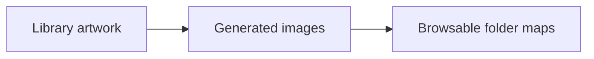

# Production wellhead

[Parent map](../README.md) · [Package owner](../../../../README.md) · [Image gallery](../../../README.md)

Generated previews from canonical equipment artwork and supplied illustrative state. Images do not run a process model. Open a preview for its full size.

| File | Preview | Equipment and supplied state |
| --- | --- | --- |
| [default.svg](default.svg) |  | Production wellhead Active illustrative preview `wellhead` Editable fields: `active`, `running`, `fault`, `status`, `load`, `open`, `value`, `damage` |
| [steam-well.svg](steam-well.svg) |  | Production wellhead — Dry-steam production well Active illustrative preview `wellhead` / `steam-well` Editable fields: `active`, `running`, `fault`, `status`, `load`, `open`, `value`, `damage` |
| [geothermal-water.svg](geothermal-water.svg) |  | Production wellhead — Geothermal liquid production well Active illustrative preview `wellhead` / `geothermal-water` Editable fields: `active`, `running`, `fault`, `status`, `load`, `open`, `value`, `damage` |
