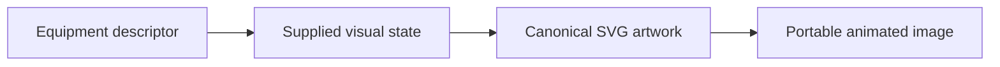

# Pumps & machinery

[Parent map](../README.md) · [Gallery](../../README.md) · [Package owner](../../../README.md) · [Interactive equipment example](../../../examples/components/index.html)

Generated from the library renderer. These images show supplied illustrative visual state; they do not run a system model. Motion follows the image viewer’s reduced-motion preference where supported. Static renderers retain the equipment and readouts.

This folder contains **24 previews**. Open an image for its full size; use the interactive example to change fields. The table lists the rendering inputs for each asset. Regenerate this map with `npm run gallery:generate`; do not edit generated SVGs or indexes.

| Preview | Equipment and supplied state |
| --- | --- |
|  | **Centrifugal pump** `pump` Active illustrative preview  Distinct pump volute, motor, flange connections and spinning impeller.  Editable fields: `active`, `running`, `fault`, `status`, `load`, `speed`, `damage`. |
|  | **Centrifugal pump — Water service** `pump` / `water` Active illustrative preview  Explicit illustrative compatibility selection; engineering service suitability is not established.  Editable fields: `active`, `running`, `fault`, `status`, `load`, `speed`, `damage`. |
|  | **Centrifugal pump — Heat-transfer fluid** `pump` / `thermal-fluid` Active illustrative preview  Explicit illustrative compatibility selection; engineering service suitability is not established.  Editable fields: `active`, `running`, `fault`, `status`, `load`, `speed`, `damage`. |
|  | **Centrifugal pump — Helium circulation** `pump` / `helium` Active illustrative preview  Explicit illustrative compatibility selection; engineering service suitability is not established.  Editable fields: `active`, `running`, `fault`, `status`, `load`, `speed`, `damage`. |
|  | **Centrifugal pump — Sodium loop concept** `pump` / `sodium` Active illustrative preview  Explicit illustrative compatibility selection; engineering service suitability is not established.  Editable fields: `active`, `running`, `fault`, `status`, `load`, `speed`, `damage`. |
|  | **Centrifugal pump — Salt loop concept** `pump` / `salt` Active illustrative preview  Explicit illustrative compatibility selection; engineering service suitability is not established.  Editable fields: `active`, `running`, `fault`, `status`, `load`, `speed`, `damage`. |
|  | **Centrifugal pump — Heavy-water loop concept** `pump` / `heavy-water` Active illustrative preview  Explicit illustrative compatibility selection; engineering service suitability is not established.  Editable fields: `active`, `running`, `fault`, `status`, `load`, `speed`, `damage`. |
|  | **Centrifugal pump — Organic working-fluid loop** `pump` / `organic-working-fluid` Active illustrative preview  Explicit illustrative compatibility selection; engineering service suitability is not established.  Editable fields: `active`, `running`, `fault`, `status`, `load`, `speed`, `damage`. |
|  | **Centrifugal pump — Liquid-fuel transfer** `pump` / `liquid-fuel` Active illustrative preview  Explicit illustrative compatibility selection; engineering service suitability is not established.  Editable fields: `active`, `running`, `fault`, `status`, `load`, `speed`, `damage`. |
|  | **Submersible pump** `submersible-pump` Active illustrative preview  Vertical sealed pump housing, suction strainer and rising discharge.  Editable fields: `active`, `running`, `fault`, `status`, `load`, `speed`, `damage`. |
|  | **Submersible pump — Water service** `submersible-pump` / `water` Active illustrative preview  Explicit illustrative compatibility selection; engineering service suitability is not established.  Editable fields: `active`, `running`, `fault`, `status`, `load`, `speed`, `damage`. |
|  | **Submersible pump — Heat-transfer fluid** `submersible-pump` / `thermal-fluid` Active illustrative preview  Explicit illustrative compatibility selection; engineering service suitability is not established.  Editable fields: `active`, `running`, `fault`, `status`, `load`, `speed`, `damage`. |
|  | **Submersible pump — Helium circulation** `submersible-pump` / `helium` Active illustrative preview  Explicit illustrative compatibility selection; engineering service suitability is not established.  Editable fields: `active`, `running`, `fault`, `status`, `load`, `speed`, `damage`. |
|  | **Submersible pump — Sodium loop concept** `submersible-pump` / `sodium` Active illustrative preview  Explicit illustrative compatibility selection; engineering service suitability is not established.  Editable fields: `active`, `running`, `fault`, `status`, `load`, `speed`, `damage`. |
|  | **Submersible pump — Salt loop concept** `submersible-pump` / `salt` Active illustrative preview  Explicit illustrative compatibility selection; engineering service suitability is not established.  Editable fields: `active`, `running`, `fault`, `status`, `load`, `speed`, `damage`. |
|  | **Submersible pump — Heavy-water loop concept** `submersible-pump` / `heavy-water` Active illustrative preview  Explicit illustrative compatibility selection; engineering service suitability is not established.  Editable fields: `active`, `running`, `fault`, `status`, `load`, `speed`, `damage`. |
|  | **Submersible pump — Organic working-fluid loop** `submersible-pump` / `organic-working-fluid` Active illustrative preview  Explicit illustrative compatibility selection; engineering service suitability is not established.  Editable fields: `active`, `running`, `fault`, `status`, `load`, `speed`, `damage`. |
|  | **Submersible pump — Liquid-fuel transfer** `submersible-pump` / `liquid-fuel` Active illustrative preview  Explicit illustrative compatibility selection; engineering service suitability is not established.  Editable fields: `active`, `running`, `fault`, `status`, `load`, `speed`, `damage`. |
|  | **Metering pump** `dosing-pump` Active illustrative preview  Compact drive and reciprocating diaphragm head for controlled chemical feed.  Editable fields: `active`, `running`, `fault`, `status`, `load`, `speed`, `damage`. |
|  | **Centrifugal blower** `blower` Active illustrative preview  Scroll housing, guarded radial fan and tangential air outlet.  Editable fields: `active`, `running`, `fault`, `status`, `load`, `speed`, `damage`. |
|  | **Centrifugal blower — Helium circulator concept** `blower` / `helium` Active illustrative preview  Scroll housing, guarded radial fan and tangential air outlet.  Editable fields: `active`, `running`, `fault`, `status`, `load`, `speed`, `damage`. |
|  | **Reciprocating compressor** `compressor` Active illustrative preview  Twin cylinders over a receiver with a cycling piston linkage.  Editable fields: `active`, `running`, `fault`, `status`, `load`, `speed`, `damage`. |
|  | **Electric motor** `motor` Active illustrative preview  Ribbed motor casing, fan guard and rotating output shaft.  Editable fields: `active`, `running`, `fault`, `status`, `load`, `speed`, `damage`. |
|  | **Axial ventilation fan** `fan` Active illustrative preview  Guarded axial fan with a duct flange, rotating blades and visible mechanical damage.  Editable fields: `active`, `running`, `fault`, `status`, `load`, `speed`, `damage`. |
