# Centrifugal blower

[Parent map](../README.md) · [Package owner](../../../../README.md) · [Image gallery](../../../README.md)

Generated previews from canonical equipment artwork and supplied illustrative state. Images do not run a process model. Open a preview for its full size.

| File | Preview | Equipment and supplied state |
| --- | --- | --- |
| [default.svg](default.svg) |  | Centrifugal blower Active illustrative preview `blower` Editable fields: `active`, `running`, `fault`, `status`, `load`, `speed`, `damage` |
| [helium.svg](helium.svg) |  | Centrifugal blower — Helium circulator concept Active illustrative preview `blower` / `helium` Editable fields: `active`, `running`, `fault`, `status`, `load`, `speed`, `damage` |
