# Valves

[Parent map](../README.md) · [Gallery](../../README.md) · [Package owner](../../../README.md) · [Interactive equipment example](../../../examples/components/index.html)

Generated from the library renderer. These images show supplied illustrative visual state; they do not run a system model. Motion follows the image viewer’s reduced-motion preference where supported. Static renderers retain the equipment and readouts.

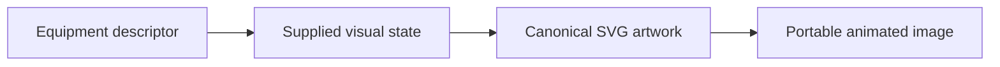

This folder contains **45 previews**. Open an image for its full size; use the interactive example to change fields. The table lists the rendering inputs for each asset. Regenerate this map with `npm run gallery:generate`; do not edit generated SVGs or indexes.

| Preview | Equipment and supplied state |
| --- | --- |
|  | **Gate valve** `gate-valve` Active illustrative preview  Flanged valve body with a lifting stem and handwheel.  Editable fields: `active`, `running`, `fault`, `status`, `open`, `opening`, `damage`. |
| <a href="gate-valve--water.svg"></a> | **Gate valve — Water service** `gate-valve` / `water` Active illustrative preview  Explicit illustrative compatibility selection; engineering service suitability is not established.  Editable fields: `active`, `running`, `fault`, `status`, `open`, `opening`, `damage`. |
|  | **Gate valve — Heat-transfer fluid** `gate-valve` / `thermal-fluid` Active illustrative preview  Explicit illustrative compatibility selection; engineering service suitability is not established.  Editable fields: `active`, `running`, `fault`, `status`, `open`, `opening`, `damage`. |
| <a href="gate-valve--helium.svg"></a> | **Gate valve — Helium circulation** `gate-valve` / `helium` Active illustrative preview  Explicit illustrative compatibility selection; engineering service suitability is not established.  Editable fields: `active`, `running`, `fault`, `status`, `open`, `opening`, `damage`. |
| <a href="gate-valve--sodium.svg"></a> | **Gate valve — Sodium loop concept** `gate-valve` / `sodium` Active illustrative preview  Explicit illustrative compatibility selection; engineering service suitability is not established.  Editable fields: `active`, `running`, `fault`, `status`, `open`, `opening`, `damage`. |
|  | **Gate valve — Salt loop concept** `gate-valve` / `salt` Active illustrative preview  Explicit illustrative compatibility selection; engineering service suitability is not established.  Editable fields: `active`, `running`, `fault`, `status`, `open`, `opening`, `damage`. |
| <a href="gate-valve--heavy-water.svg"></a> | **Gate valve — Heavy-water loop concept** `gate-valve` / `heavy-water` Active illustrative preview  Explicit illustrative compatibility selection; engineering service suitability is not established.  Editable fields: `active`, `running`, `fault`, `status`, `open`, `opening`, `damage`. |
| <a href="gate-valve--organic-working-fluid.svg"></a> | **Gate valve — Organic working-fluid loop** `gate-valve` / `organic-working-fluid` Active illustrative preview  Explicit illustrative compatibility selection; engineering service suitability is not established.  Editable fields: `active`, `running`, `fault`, `status`, `open`, `opening`, `damage`. |
| <a href="gate-valve--liquid-fuel.svg"></a> | **Gate valve — Liquid-fuel transfer** `gate-valve` / `liquid-fuel` Active illustrative preview  Explicit illustrative compatibility selection; engineering service suitability is not established.  Editable fields: `active`, `running`, `fault`, `status`, `open`, `opening`, `damage`. |
| <a href="control-valve.svg"></a> | **Control valve** `control-valve` Active illustrative preview  Process valve with a pneumatic diaphragm actuator and control signal.  Editable fields: `active`, `running`, `fault`, `status`, `open`, `opening`, `damage`. |
| <a href="control-valve--water.svg"></a> | **Control valve — Water service** `control-valve` / `water` Active illustrative preview  Explicit illustrative compatibility selection; engineering service suitability is not established.  Editable fields: `active`, `running`, `fault`, `status`, `open`, `opening`, `damage`. |
| <a href="control-valve--thermal-fluid.svg"></a> | **Control valve — Heat-transfer fluid** `control-valve` / `thermal-fluid` Active illustrative preview  Explicit illustrative compatibility selection; engineering service suitability is not established.  Editable fields: `active`, `running`, `fault`, `status`, `open`, `opening`, `damage`. |
| <a href="control-valve--helium.svg"></a> | **Control valve — Helium circulation** `control-valve` / `helium` Active illustrative preview  Explicit illustrative compatibility selection; engineering service suitability is not established.  Editable fields: `active`, `running`, `fault`, `status`, `open`, `opening`, `damage`. |
|  | **Control valve — Sodium loop concept** `control-valve` / `sodium` Active illustrative preview  Explicit illustrative compatibility selection; engineering service suitability is not established.  Editable fields: `active`, `running`, `fault`, `status`, `open`, `opening`, `damage`. |
| <a href="control-valve--salt.svg"></a> | **Control valve — Salt loop concept** `control-valve` / `salt` Active illustrative preview  Explicit illustrative compatibility selection; engineering service suitability is not established.  Editable fields: `active`, `running`, `fault`, `status`, `open`, `opening`, `damage`. |
| <a href="control-valve--heavy-water.svg"></a> | **Control valve — Heavy-water loop concept** `control-valve` / `heavy-water` Active illustrative preview  Explicit illustrative compatibility selection; engineering service suitability is not established.  Editable fields: `active`, `running`, `fault`, `status`, `open`, `opening`, `damage`. |
| <a href="control-valve--organic-working-fluid.svg"></a> | **Control valve — Organic working-fluid loop** `control-valve` / `organic-working-fluid` Active illustrative preview  Explicit illustrative compatibility selection; engineering service suitability is not established.  Editable fields: `active`, `running`, `fault`, `status`, `open`, `opening`, `damage`. |
| <a href="control-valve--liquid-fuel.svg"></a> | **Control valve — Liquid-fuel transfer** `control-valve` / `liquid-fuel` Active illustrative preview  Explicit illustrative compatibility selection; engineering service suitability is not established.  Editable fields: `active`, `running`, `fault`, `status`, `open`, `opening`, `damage`. |
|  | **Check valve** `check-valve` Active illustrative preview  Direction arrow and a hinged internal flap showing the permitted flow path.  Editable fields: `active`, `running`, `fault`, `status`, `open`, `damage`. |
|  | **Check valve — Water service** `check-valve` / `water` Active illustrative preview  Explicit illustrative compatibility selection; engineering service suitability is not established.  Editable fields: `active`, `running`, `fault`, `status`, `open`, `damage`. |
| <a href="check-valve--thermal-fluid.svg"></a> | **Check valve — Heat-transfer fluid** `check-valve` / `thermal-fluid` Active illustrative preview  Explicit illustrative compatibility selection; engineering service suitability is not established.  Editable fields: `active`, `running`, `fault`, `status`, `open`, `damage`. |
|  | **Check valve — Helium circulation** `check-valve` / `helium` Active illustrative preview  Explicit illustrative compatibility selection; engineering service suitability is not established.  Editable fields: `active`, `running`, `fault`, `status`, `open`, `damage`. |
| <a href="check-valve--sodium.svg"></a> | **Check valve — Sodium loop concept** `check-valve` / `sodium` Active illustrative preview  Explicit illustrative compatibility selection; engineering service suitability is not established.  Editable fields: `active`, `running`, `fault`, `status`, `open`, `damage`. |
|  | **Check valve — Salt loop concept** `check-valve` / `salt` Active illustrative preview  Explicit illustrative compatibility selection; engineering service suitability is not established.  Editable fields: `active`, `running`, `fault`, `status`, `open`, `damage`. |
| <a href="check-valve--heavy-water.svg"></a> | **Check valve — Heavy-water loop concept** `check-valve` / `heavy-water` Active illustrative preview  Explicit illustrative compatibility selection; engineering service suitability is not established.  Editable fields: `active`, `running`, `fault`, `status`, `open`, `damage`. |
|  | **Check valve — Organic working-fluid loop** `check-valve` / `organic-working-fluid` Active illustrative preview  Explicit illustrative compatibility selection; engineering service suitability is not established.  Editable fields: `active`, `running`, `fault`, `status`, `open`, `damage`. |
| <a href="check-valve--liquid-fuel.svg"></a> | **Check valve — Liquid-fuel transfer** `check-valve` / `liquid-fuel` Active illustrative preview  Explicit illustrative compatibility selection; engineering service suitability is not established.  Editable fields: `active`, `running`, `fault`, `status`, `open`, `damage`. |
| <a href="relief-valve.svg"></a> | **Pressure relief valve** `relief-valve` Active illustrative preview  Spring-loaded relief body with a distinct upward vent connection.  Editable fields: `active`, `running`, `fault`, `status`, `open`, `damage`. |
| <a href="relief-valve--water.svg"></a> | **Pressure relief valve — Water service** `relief-valve` / `water` Active illustrative preview  Explicit illustrative compatibility selection; engineering service suitability is not established.  Editable fields: `active`, `running`, `fault`, `status`, `open`, `damage`. |
|  | **Pressure relief valve — Heat-transfer fluid** `relief-valve` / `thermal-fluid` Active illustrative preview  Explicit illustrative compatibility selection; engineering service suitability is not established.  Editable fields: `active`, `running`, `fault`, `status`, `open`, `damage`. |
|  | **Pressure relief valve — Helium circulation** `relief-valve` / `helium` Active illustrative preview  Explicit illustrative compatibility selection; engineering service suitability is not established.  Editable fields: `active`, `running`, `fault`, `status`, `open`, `damage`. |
|  | **Pressure relief valve — Sodium loop concept** `relief-valve` / `sodium` Active illustrative preview  Explicit illustrative compatibility selection; engineering service suitability is not established.  Editable fields: `active`, `running`, `fault`, `status`, `open`, `damage`. |
| <a href="relief-valve--salt.svg"></a> | **Pressure relief valve — Salt loop concept** `relief-valve` / `salt` Active illustrative preview  Explicit illustrative compatibility selection; engineering service suitability is not established.  Editable fields: `active`, `running`, `fault`, `status`, `open`, `damage`. |
| <a href="relief-valve--heavy-water.svg"></a> | **Pressure relief valve — Heavy-water loop concept** `relief-valve` / `heavy-water` Active illustrative preview  Explicit illustrative compatibility selection; engineering service suitability is not established.  Editable fields: `active`, `running`, `fault`, `status`, `open`, `damage`. |
| <a href="relief-valve--organic-working-fluid.svg"></a> | **Pressure relief valve — Organic working-fluid loop** `relief-valve` / `organic-working-fluid` Active illustrative preview  Explicit illustrative compatibility selection; engineering service suitability is not established.  Editable fields: `active`, `running`, `fault`, `status`, `open`, `damage`. |
| <a href="relief-valve--liquid-fuel.svg"></a> | **Pressure relief valve — Liquid-fuel transfer** `relief-valve` / `liquid-fuel` Active illustrative preview  Explicit illustrative compatibility selection; engineering service suitability is not established.  Editable fields: `active`, `running`, `fault`, `status`, `open`, `damage`. |
| <a href="butterfly-valve.svg"></a> | **Butterfly valve** `butterfly-valve` Active illustrative preview  Circular wafer body with a quarter-turn disc and lever.  Editable fields: `active`, `running`, `fault`, `status`, `open`, `opening`, `damage`. |
| <a href="butterfly-valve--water.svg"></a> | **Butterfly valve — Water service** `butterfly-valve` / `water` Active illustrative preview  Explicit illustrative compatibility selection; engineering service suitability is not established.  Editable fields: `active`, `running`, `fault`, `status`, `open`, `opening`, `damage`. |
| <a href="butterfly-valve--thermal-fluid.svg"></a> | **Butterfly valve — Heat-transfer fluid** `butterfly-valve` / `thermal-fluid` Active illustrative preview  Explicit illustrative compatibility selection; engineering service suitability is not established.  Editable fields: `active`, `running`, `fault`, `status`, `open`, `opening`, `damage`. |
| <a href="butterfly-valve--helium.svg"></a> | **Butterfly valve — Helium circulation** `butterfly-valve` / `helium` Active illustrative preview  Explicit illustrative compatibility selection; engineering service suitability is not established.  Editable fields: `active`, `running`, `fault`, `status`, `open`, `opening`, `damage`. |
| <a href="butterfly-valve--sodium.svg"></a> | **Butterfly valve — Sodium loop concept** `butterfly-valve` / `sodium` Active illustrative preview  Explicit illustrative compatibility selection; engineering service suitability is not established.  Editable fields: `active`, `running`, `fault`, `status`, `open`, `opening`, `damage`. |
| <a href="butterfly-valve--salt.svg"></a> | **Butterfly valve — Salt loop concept** `butterfly-valve` / `salt` Active illustrative preview  Explicit illustrative compatibility selection; engineering service suitability is not established.  Editable fields: `active`, `running`, `fault`, `status`, `open`, `opening`, `damage`. |
|  | **Butterfly valve — Heavy-water loop concept** `butterfly-valve` / `heavy-water` Active illustrative preview  Explicit illustrative compatibility selection; engineering service suitability is not established.  Editable fields: `active`, `running`, `fault`, `status`, `open`, `opening`, `damage`. |
| <a href="butterfly-valve--organic-working-fluid.svg"></a> | **Butterfly valve — Organic working-fluid loop** `butterfly-valve` / `organic-working-fluid` Active illustrative preview  Explicit illustrative compatibility selection; engineering service suitability is not established.  Editable fields: `active`, `running`, `fault`, `status`, `open`, `opening`, `damage`. |
| <a href="butterfly-valve--liquid-fuel.svg"></a> | **Butterfly valve — Liquid-fuel transfer** `butterfly-valve` / `liquid-fuel` Active illustrative preview  Explicit illustrative compatibility selection; engineering service suitability is not established.  Editable fields: `active`, `running`, `fault`, `status`, `open`, `opening`, `damage`. |
