# Butterfly valve

[Parent map](../README.md) · [Package owner](../../../../README.md) · [Image gallery](../../../README.md)

Generated previews from canonical equipment artwork and supplied illustrative state. Images do not run a process model. Open a preview for its full size.

| File | Preview | Equipment and supplied state |
| --- | --- | --- |
| [default.svg](default.svg) |  | Butterfly valve Active illustrative preview `butterfly-valve` Editable fields: `active`, `running`, `fault`, `status`, `open`, `opening`, `damage` |
| [water.svg](water.svg) |  | Butterfly valve — Water service Active illustrative preview `butterfly-valve` / `water` Editable fields: `active`, `running`, `fault`, `status`, `open`, `opening`, `damage` |
| [thermal-fluid.svg](thermal-fluid.svg) |  | Butterfly valve — Heat-transfer fluid Active illustrative preview `butterfly-valve` / `thermal-fluid` Editable fields: `active`, `running`, `fault`, `status`, `open`, `opening`, `damage` |
| [helium.svg](helium.svg) |  | Butterfly valve — Helium circulation Active illustrative preview `butterfly-valve` / `helium` Editable fields: `active`, `running`, `fault`, `status`, `open`, `opening`, `damage` |
| [sodium.svg](sodium.svg) |  | Butterfly valve — Sodium loop concept Active illustrative preview `butterfly-valve` / `sodium` Editable fields: `active`, `running`, `fault`, `status`, `open`, `opening`, `damage` |
| [salt.svg](salt.svg) |  | Butterfly valve — Salt loop concept Active illustrative preview `butterfly-valve` / `salt` Editable fields: `active`, `running`, `fault`, `status`, `open`, `opening`, `damage` |
| [heavy-water.svg](heavy-water.svg) |  | Butterfly valve — Heavy-water loop concept Active illustrative preview `butterfly-valve` / `heavy-water` Editable fields: `active`, `running`, `fault`, `status`, `open`, `opening`, `damage` |
| [organic-working-fluid.svg](organic-working-fluid.svg) |  | Butterfly valve — Organic working-fluid loop Active illustrative preview `butterfly-valve` / `organic-working-fluid` Editable fields: `active`, `running`, `fault`, `status`, `open`, `opening`, `damage` |
| [liquid-fuel.svg](liquid-fuel.svg) |  | Butterfly valve — Liquid-fuel transfer Active illustrative preview `butterfly-valve` / `liquid-fuel` Editable fields: `active`, `running`, `fault`, `status`, `open`, `opening`, `damage` |
