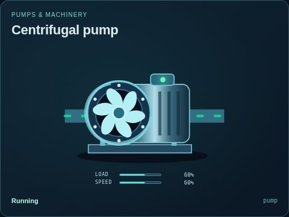
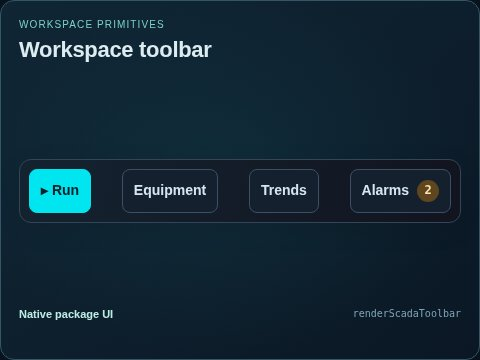
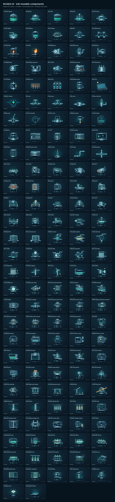

# Static UI previews

[Parent map](../README.md) · [Package owner](../../README.md) · [Image gallery](../README.md)

Generated previews from canonical equipment artwork and supplied illustrative state. Images do not run a process model. Open a preview for its full size.

| Folder | Previews | Example |
| --- | ---: | --- |
| [Equipment](equipment/README.md) | 239 |  |
| [States](states/README.md) | 6 |  |
| [Workspace](workspace/README.md) | 7 |  |

| File | Preview | Equipment and supplied state |
| --- | --- | --- |
| [contact-sheet.jpg](contact-sheet.jpg) |  | All equipment contact sheet Fixed illustrative preview |
