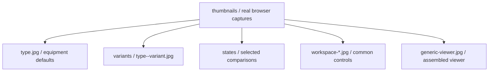

# Viewer and workspace snapshots

[Parent image gallery](../README.md) · [Package owner](../../README.md) · [Equipment catalog](../../README.md#equipment-catalog) · [Capture manifest](../../metadata/thumbnails.json)

These source-derived JPEG captures preserve a static fallback for every equipment type and variant. The package map contains the full equipment table; animated equipment previews live in [the family gallery](../README.md). This page collects the UI primitives and reusable viewer, which remain real HTML controls rather than standalone SVG pictures.

| Folder or filename | Browse it here |
| --- | --- |
| `<type>.jpg` | [Equipment catalog](../../README.md#equipment-catalog), with one capture per default type. |
| [variants/](./variants/README.md) | Declared equipment variants and the generated variant inventory. |
| [states/](./states/README.md) | Selected static state comparisons, linked to animated examples. |
| `workspace-*.jpg`, `generic-viewer.jpg` | Reusable UI elements below. |
| `contact-sheet.jpg` | [Full capture inventory](./contact-sheet.jpg). |

The capture tool owns JPEGs and their manifest; these folder maps are authored documentation. Run `npm run thumbnails` when rendering inputs change and `npm run thumbnails -- --check` to validate existing captures. A documentation edit does not require new screenshots.

| UI element | Snapshot |
| --- | --- |
| Toolbar |  |
| Equipment dialog |  |
| Status bar |  |
| Buttons |  |
| Inspector panels |  |
| Metrics |  |
| Reusable system viewer |  |

[Run the viewer example](../../examples/viewer/index.html) to exercise selection, model commands, inspectors, pan/zoom and Zoom to fit. Static screenshots do not demonstrate those interactions.

| Visual state fallback | Snapshot |
| --- | --- |
| Pump running |  |
| Pump stopped |  |
| Tank empty |  |
| Tank full |  |
| PLC warning |  |
| PLC fault |  |

[Animated state examples](../states/README.md) add valve opening, speed/load, connection, flame and damage states. Every preview lists an illustrative supplied state in its manifest; none is an engineering model.
