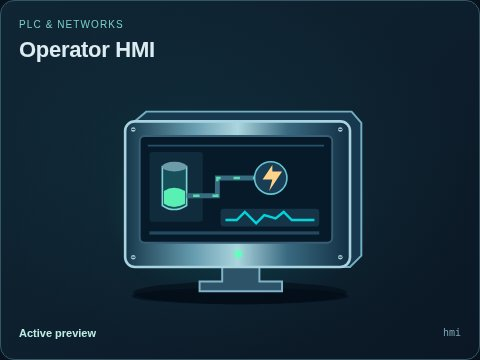
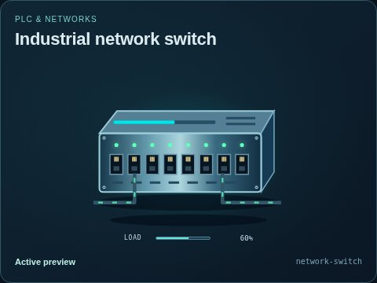
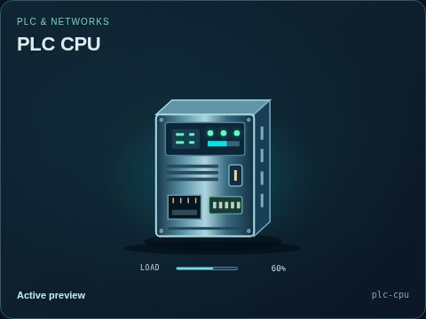
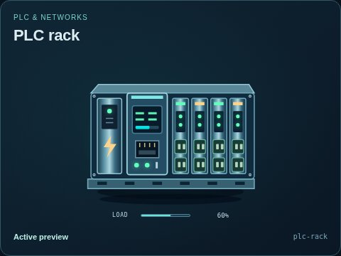
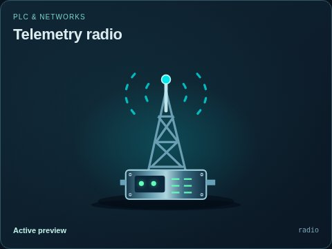
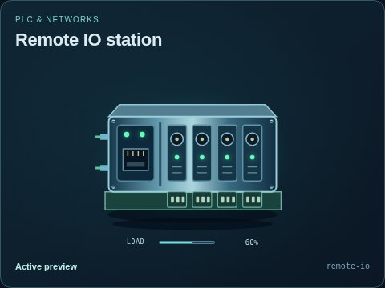
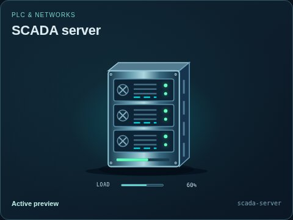

# PLC & networks

[Parent map](../README.md) · [Package owner](../../../../README.md) · [Image gallery](../../../README.md)

Generated previews from canonical equipment artwork and supplied illustrative state. Images do not run a process model. Open a preview for its full size.

| Folder | Previews | Example |
| --- | ---: | --- |
| [Operator HMI](hmi/README.md) | 1 |  |
| [Industrial network switch](network-switch/README.md) | 1 |  |
| [PLC CPU](plc-cpu/README.md) | 1 |  |
| [PLC rack](plc-rack/README.md) | 1 |  |
| [Telemetry radio](radio/README.md) | 1 |  |
| [Remote IO station](remote-io/README.md) | 1 |  |
| [SCADA server](scada-server/README.md) | 1 |  |
