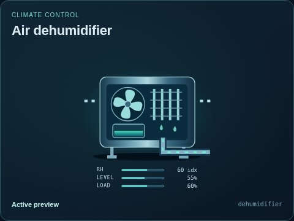
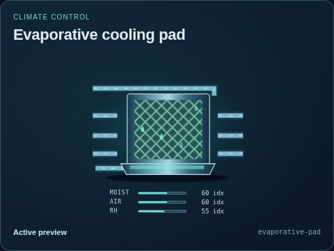
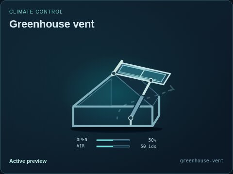
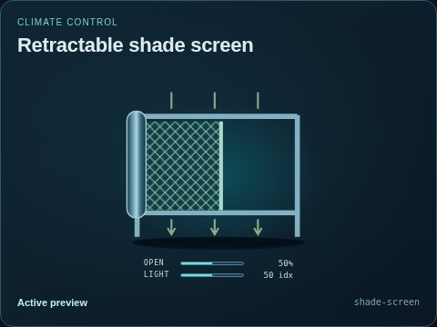

# Climate control

[Parent map](../README.md) · [Package owner](../../../../README.md) · [Image gallery](../../../README.md)

Generated previews from canonical equipment artwork and supplied illustrative state. Images do not run a process model. Open a preview for its full size.

| Folder | Previews | Example |
| --- | ---: | --- |
| [Air dehumidifier](dehumidifier/README.md) | 1 |  |
| [Evaporative cooling pad](evaporative-pad/README.md) | 1 |  |
| [Greenhouse vent](greenhouse-vent/README.md) | 1 |  |
| [Retractable shade screen](shade-screen/README.md) | 1 |  |
