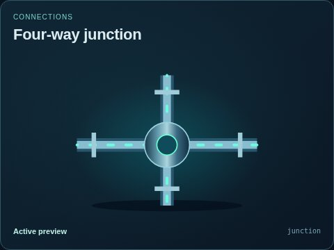
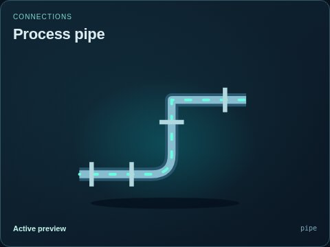

# Connections

[Parent map](../README.md) · [Package owner](../../../../README.md) · [Image gallery](../../../README.md)

Generated previews from canonical equipment artwork and supplied illustrative state. Images do not run a process model. Open a preview for its full size.

| Folder | Previews | Example |
| --- | ---: | --- |
| [Four-way junction](junction/README.md) | 1 |  |
| [Process pipe](pipe/README.md) | 9 |  |
