# Nuclear systems

[Parent map](../README.md) · [Package owner](../../../../README.md) · [Image gallery](../../../README.md)

Generated previews from canonical equipment artwork and supplied illustrative state. Images do not run a process model. Open a preview for its full size.

| Folder | Previews | Example |
| --- | ---: | --- |
| [Boiling-water reactor vessel](bwr-reactor-vessel/README.md) | 1 | <a href="bwr-reactor-vessel/default.jpg">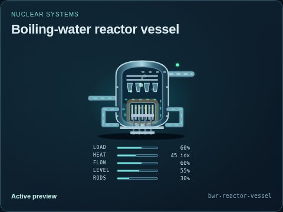</a> |
| [Containment structure](containment-structure/README.md) | 1 | <a href="containment-structure/default.jpg">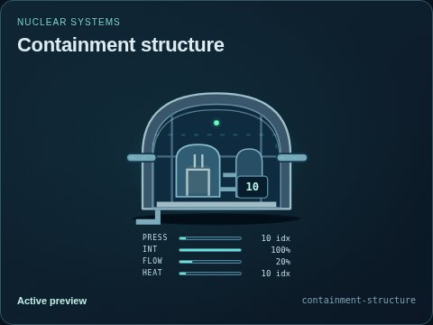</a> |
| [Control-rod drive indicator](control-rod-drive/README.md) | 1 | <a href="control-rod-drive/default.jpg">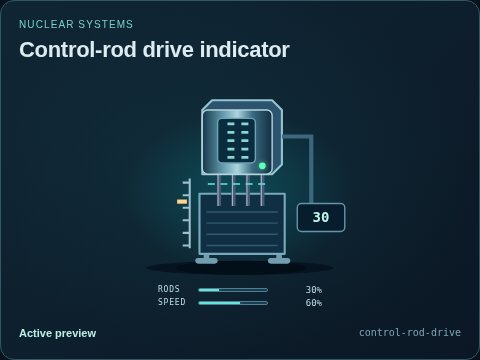</a> |
| [Gas-cooled reactor concept](gas-cooled-reactor/README.md) | 1 | <a href="gas-cooled-reactor/default.jpg">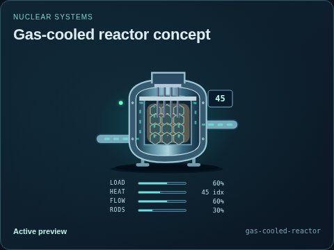</a> |
| [Molten-salt reactor concept](molten-salt-reactor/README.md) | 2 | <a href="molten-salt-reactor/default.jpg">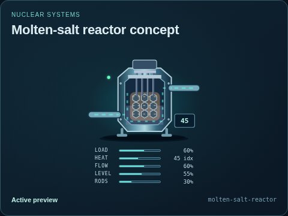</a> |
| [Neutron monitor concept](neutron-monitor/README.md) | 1 | <a href="neutron-monitor/default.jpg">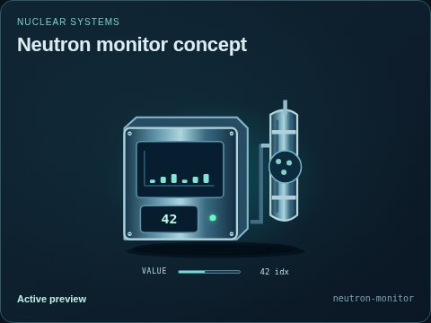</a> |
| [Nuclear steam generator](nuclear-steam-generator/README.md) | 6 | <a href="nuclear-steam-generator/default.jpg">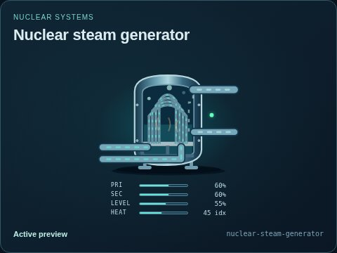</a> |
| [PHWR calandria and pressure channels](phwr-calandria/README.md) | 1 | <a href="phwr-calandria/default.jpg">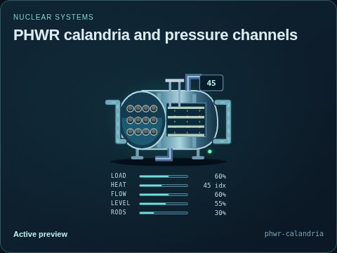</a> |
| [Pressurizer](pressurizer/README.md) | 1 | <a href="pressurizer/default.jpg">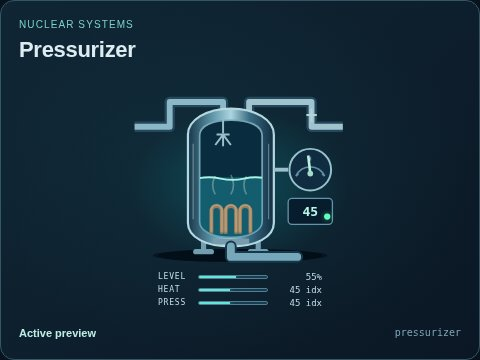</a> |
| [Pressurized-water reactor vessel](pwr-reactor-vessel/README.md) | 1 | <a href="pwr-reactor-vessel/default.jpg">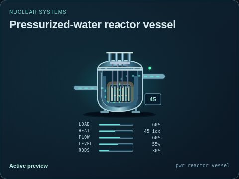</a> |
| [Radiation monitor concept](radiation-monitor/README.md) | 1 | <a href="radiation-monitor/default.jpg">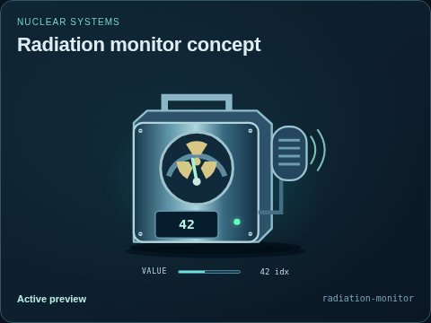</a> |
| [Sodium-cooled reactor concept](sodium-reactor-vessel/README.md) | 1 | <a href="sodium-reactor-vessel/default.jpg">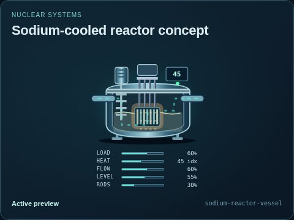</a> |
| [Used-fuel cooling pool](used-fuel-pool/README.md) | 1 | <a href="used-fuel-pool/default.jpg">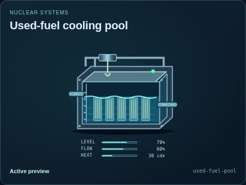</a> |
