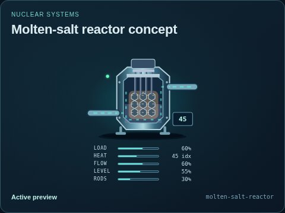
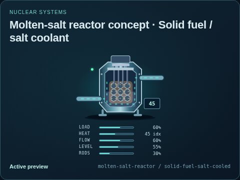

# Molten-salt reactor concept

[Parent map](../README.md) · [Package owner](../../../../../README.md) · [Image gallery](../../../../README.md)

Generated previews from canonical equipment artwork and supplied illustrative state. Images do not run a process model. Open a preview for its full size.

| File | Preview | Equipment and supplied state |
| --- | --- | --- |
| [default.jpg](default.jpg) |  | Molten-salt reactor concept Fixed illustrative preview `molten-salt-reactor` |
| [solid-fuel-salt-cooled.jpg](solid-fuel-salt-cooled.jpg) |  | Solid fuel / salt coolant Fixed illustrative preview `molten-salt-reactor` / `solid-fuel-salt-cooled` |
