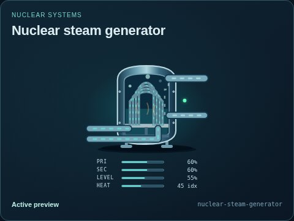
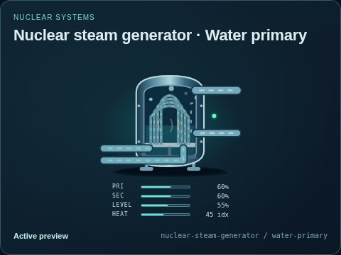
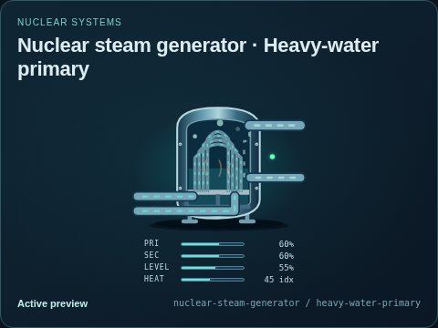
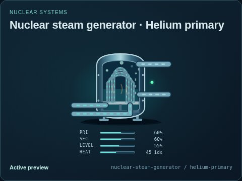
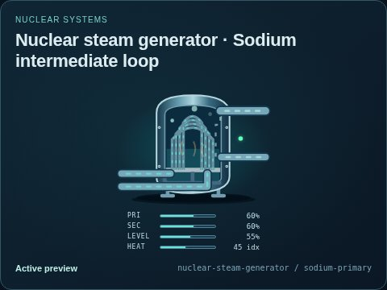
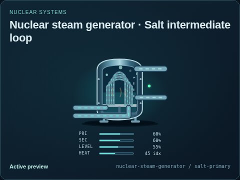

# Nuclear steam generator

[Parent map](../README.md) · [Package owner](../../../../../README.md) · [Image gallery](../../../../README.md)

Generated previews from canonical equipment artwork and supplied illustrative state. Images do not run a process model. Open a preview for its full size.

| File | Preview | Equipment and supplied state |
| --- | --- | --- |
| [default.jpg](default.jpg) |  | Nuclear steam generator Fixed illustrative preview `nuclear-steam-generator` |
| [water-primary.jpg](water-primary.jpg) |  | Water primary Fixed illustrative preview `nuclear-steam-generator` / `water-primary` |
| [heavy-water-primary.jpg](heavy-water-primary.jpg) |  | Heavy-water primary Fixed illustrative preview `nuclear-steam-generator` / `heavy-water-primary` |
| [helium-primary.jpg](helium-primary.jpg) |  | Helium primary Fixed illustrative preview `nuclear-steam-generator` / `helium-primary` |
| [sodium-primary.jpg](sodium-primary.jpg) |  | Sodium intermediate loop Fixed illustrative preview `nuclear-steam-generator` / `sodium-primary` |
| [salt-primary.jpg](salt-primary.jpg) |  | Salt intermediate loop Fixed illustrative preview `nuclear-steam-generator` / `salt-primary` |
