# Power & energy

[Parent map](../README.md) · [Package owner](../../../../README.md) · [Image gallery](../../../README.md)

Generated previews from canonical equipment artwork and supplied illustrative state. Images do not run a process model. Open a preview for its full size.

| Folder | Previews | Example |
| --- | ---: | --- |
| [Synchronous alternator](alternator/README.md) | 3 | <a href="alternator/default.jpg">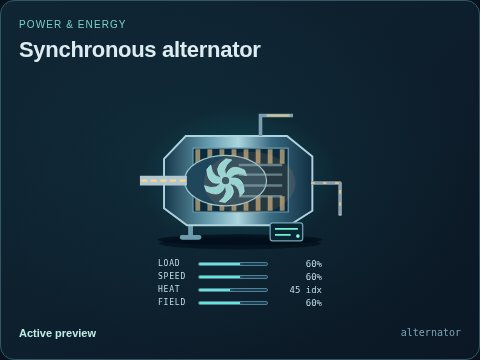</a> |
| [Automatic transfer switch](automatic-transfer-switch/README.md) | 1 | <a href="automatic-transfer-switch/default.jpg">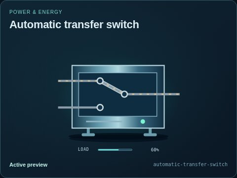</a> |
| [Battery bank](battery/README.md) | 1 | <a href="battery/default.jpg">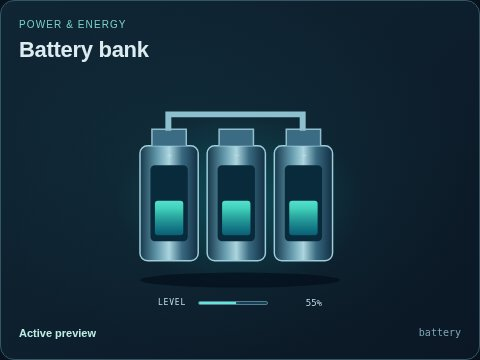</a> |
| [Circuit breaker](breaker/README.md) | 1 | <a href="breaker/default.jpg">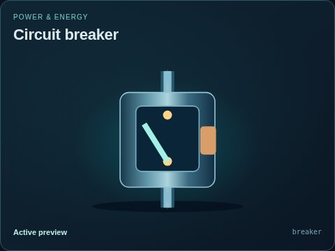</a> |
| [Distribution bus](busbar/README.md) | 2 | <a href="busbar/default.jpg">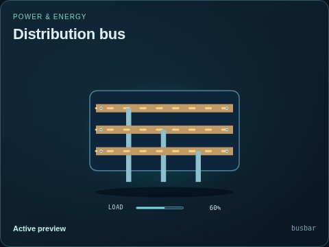</a> |
| [Switched capacitor bank](capacitor-bank/README.md) | 1 | <a href="capacitor-bank/default.jpg">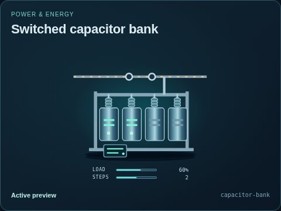</a> |
| [Cooling radiator](cooling-radiator/README.md) | 1 | <a href="cooling-radiator/default.jpg">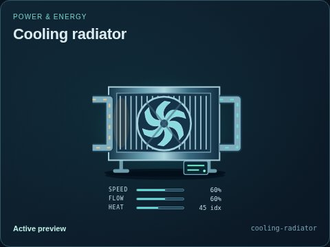</a> |
| [Current transformer](current-transformer/README.md) | 1 | <a href="current-transformer/default.jpg">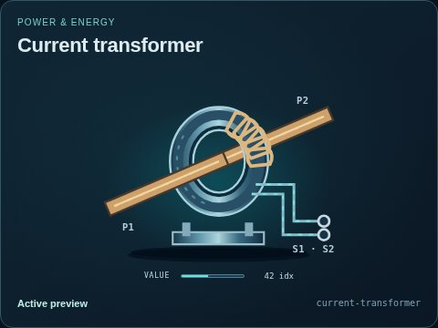</a> |
| [Feedwater deaerator](deaerator/README.md) | 1 | <a href="deaerator/default.jpg">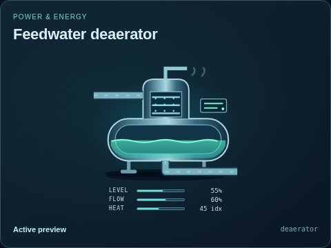</a> |
| [Air-break disconnect switch](disconnect-switch/README.md) | 3 | <a href="disconnect-switch/default.jpg">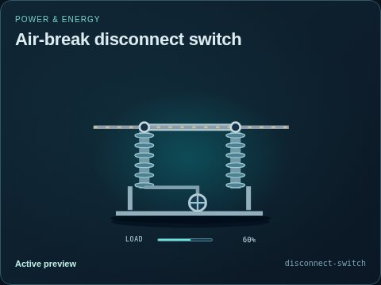</a> |
| [Earthing switch](earthing-switch/README.md) | 1 | <a href="earthing-switch/default.jpg">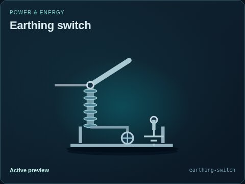</a> |
| [Net power indicator](electrical-meter/README.md) | 1 | <a href="electrical-meter/default.jpg">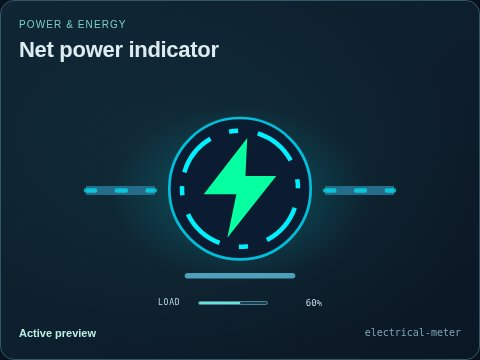</a> |
| [Water electrolyzer](electrolyzer/README.md) | 1 | <a href="electrolyzer/default.jpg">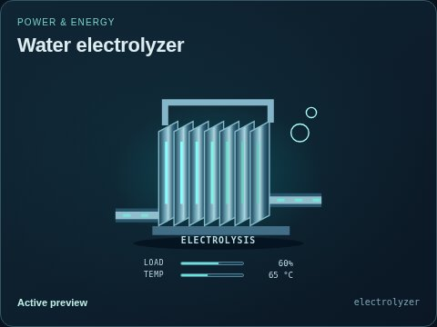</a> |
| [Generator excitation system](excitation-system/README.md) | 1 | <a href="excitation-system/default.jpg">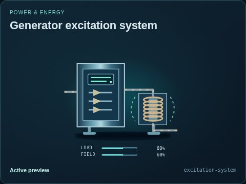</a> |
| [Fuel-cell generator](fuel-cell/README.md) | 1 | <a href="fuel-cell/default.jpg">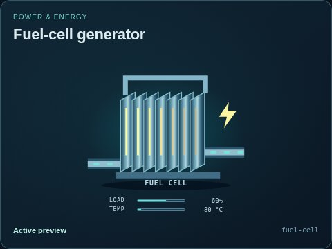</a> |
| [Fuel pressure regulator](fuel-pressure-regulator/README.md) | 1 | <a href="fuel-pressure-regulator/default.jpg">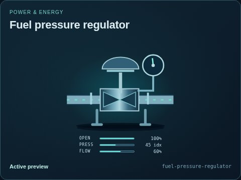</a> |
| [Combustion gas turbine](gas-turbine/README.md) | 1 | <a href="gas-turbine/default.jpg">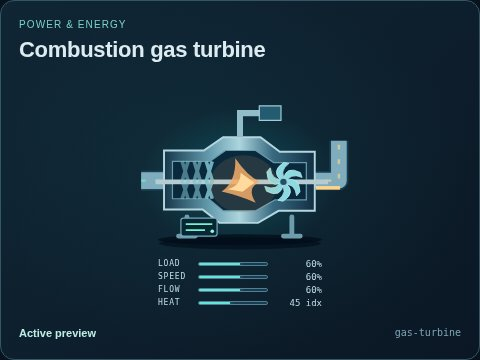</a> |
| [Microturbine generator](generator/README.md) | 6 | <a href="generator/default.jpg">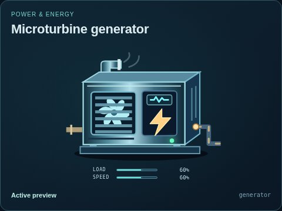</a> |
| [Gas-insulated switchgear bay](gis-bay/README.md) | 1 | <a href="gis-bay/default.jpg">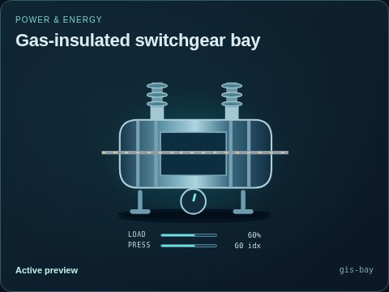</a> |
| [Heat recovery steam generator](heat-recovery-steam-generator/README.md) | 1 | <a href="heat-recovery-steam-generator/default.jpg">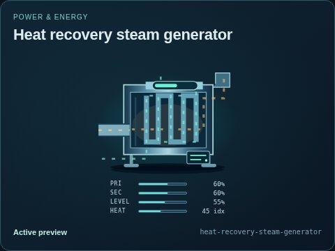</a> |
| [Heliostat mirror](heliostat/README.md) | 1 | <a href="heliostat/default.jpg">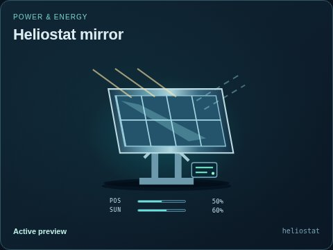</a> |
| [High-voltage circuit breaker](hv-circuit-breaker/README.md) | 1 | <a href="hv-circuit-breaker/default.jpg">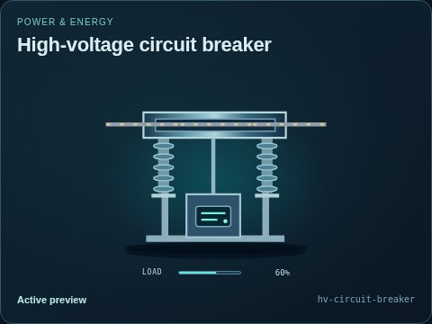</a> |
| [Hydraulic turbine](hydro-turbine/README.md) | 1 | <a href="hydro-turbine/default.jpg">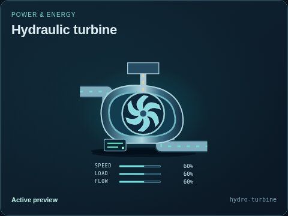</a> |
| [Hydraulic intake gate](intake-gate/README.md) | 1 | <a href="intake-gate/default.jpg">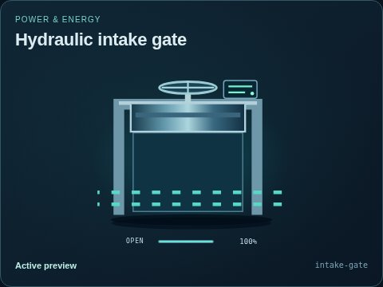</a> |
| [Parabolic-trough collector](parabolic-trough/README.md) | 1 | <a href="parabolic-trough/default.jpg">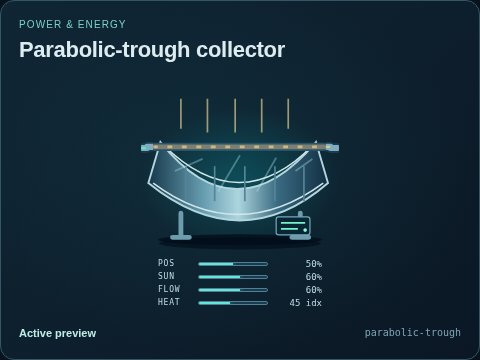</a> |
| [DC/AC power inverter](power-inverter/README.md) | 3 | <a href="power-inverter/default.jpg">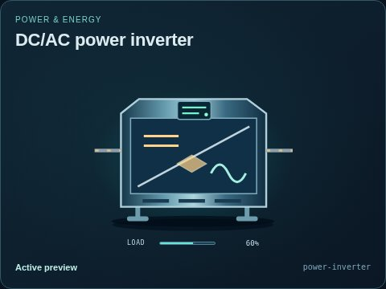</a> |
| [AC/DC rectifier](power-rectifier/README.md) | 1 | <a href="power-rectifier/default.jpg">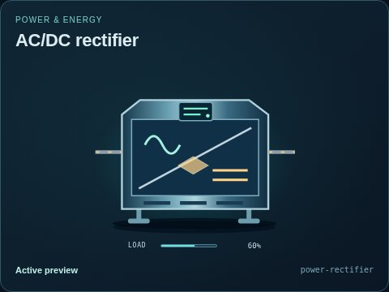</a> |
| [Protection relay](protection-relay/README.md) | 1 | <a href="protection-relay/default.jpg">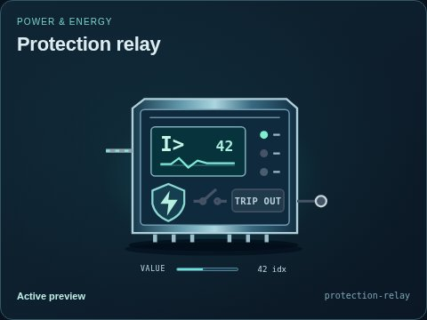</a> |
| [Water reservoir](reservoir/README.md) | 1 | <a href="reservoir/default.jpg">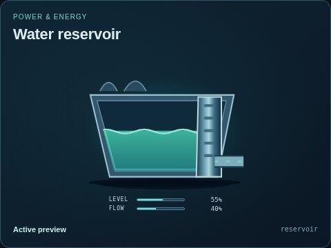</a> |
| [Reversible pump-turbine](reversible-pump-turbine/README.md) | 1 | <a href="reversible-pump-turbine/default.jpg">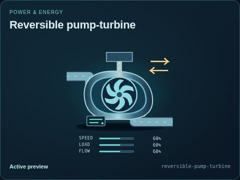</a> |
| [Shunt reactor](shunt-reactor/README.md) | 1 | <a href="shunt-reactor/default.jpg">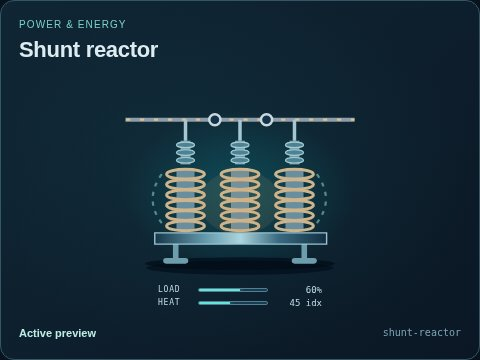</a> |
| [Solar array](solar-panel/README.md) | 1 | <a href="solar-panel/default.jpg">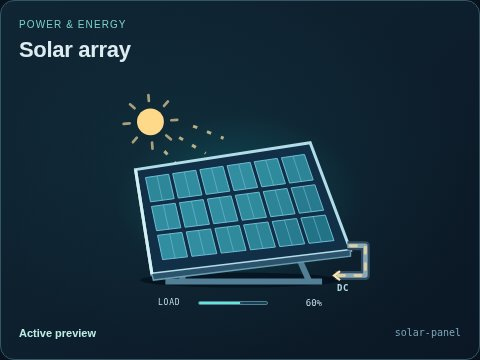</a> |
| [Solar tower receiver](solar-receiver/README.md) | 1 | <a href="solar-receiver/default.jpg">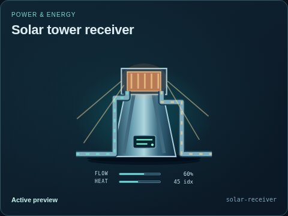</a> |
| [Steam turbine](steam-turbine/README.md) | 1 | <a href="steam-turbine/default.jpg">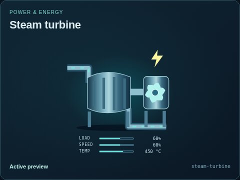</a> |
| [Surface condenser](surface-condenser/README.md) | 1 | <a href="surface-condenser/default.jpg">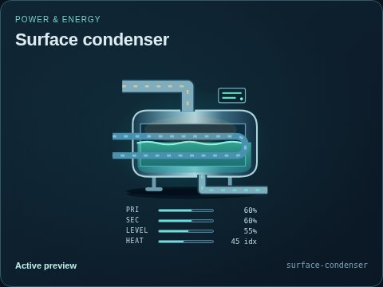</a> |
| [Surge arrester](surge-arrester/README.md) | 1 | <a href="surge-arrester/default.jpg">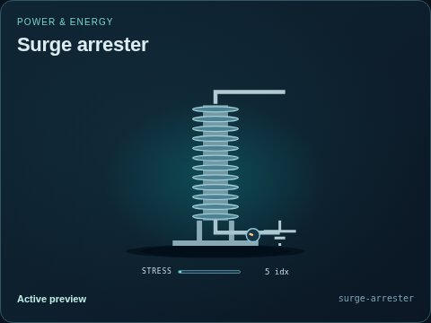</a> |
| [Metal-clad switchgear panel](switchgear-panel/README.md) | 1 | <a href="switchgear-panel/default.jpg">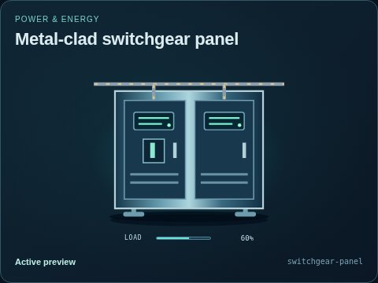</a> |
| [Tidal-current turbine](tidal-turbine/README.md) | 1 | <a href="tidal-turbine/default.jpg">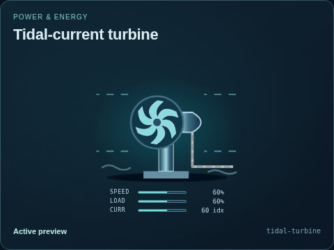</a> |
| [Power transformer](transformer/README.md) | 1 | <a href="transformer/default.jpg">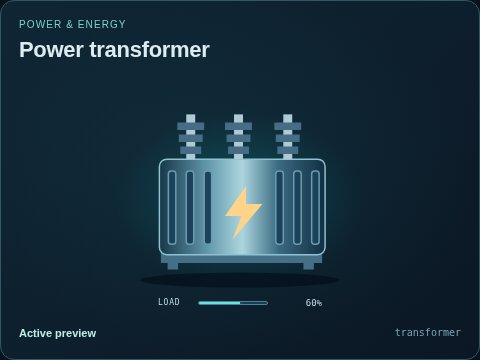</a> |
| [Uninterruptible supply](ups/README.md) | 1 | <a href="ups/default.jpg">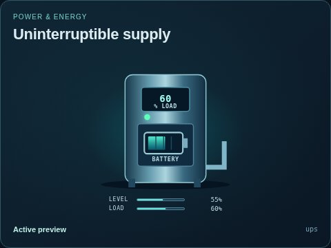</a> |
| [Voltage transformer](voltage-transformer/README.md) | 1 | <a href="voltage-transformer/default.jpg">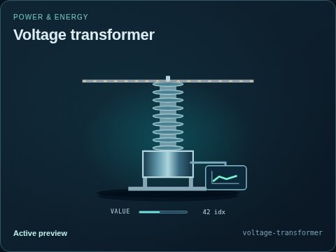</a> |
| [Wave point absorber](wave-energy-converter/README.md) | 1 | <a href="wave-energy-converter/default.jpg">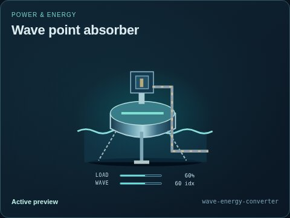</a> |
| [Wind turbine](wind-turbine/README.md) | 1 | <a href="wind-turbine/default.jpg">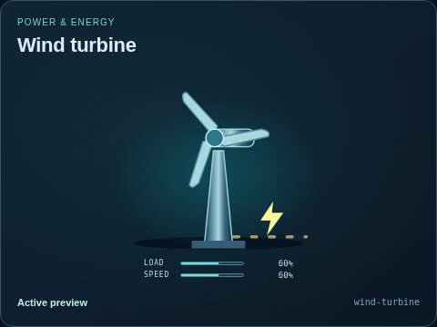</a> |
