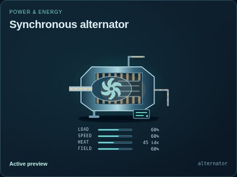
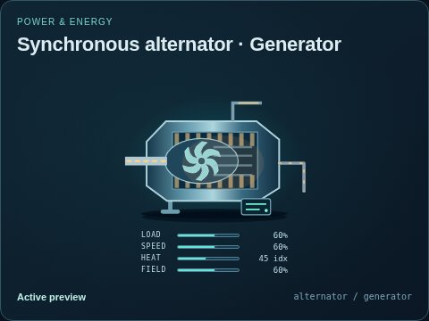
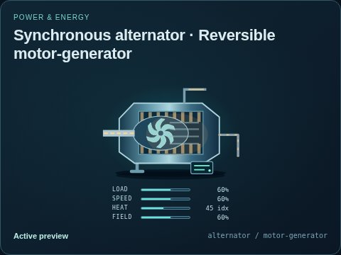

# Synchronous alternator

[Parent map](../README.md) · [Package owner](../../../../../README.md) · [Image gallery](../../../../README.md)

Generated previews from canonical equipment artwork and supplied illustrative state. Images do not run a process model. Open a preview for its full size.

| File | Preview | Equipment and supplied state |
| --- | --- | --- |
| [default.jpg](default.jpg) |  | Synchronous alternator Fixed illustrative preview `alternator` |
| [generator.jpg](generator.jpg) |  | Generator Fixed illustrative preview `alternator` / `generator` |
| [motor-generator.jpg](motor-generator.jpg) |  | Reversible motor-generator Fixed illustrative preview `alternator` / `motor-generator` |
