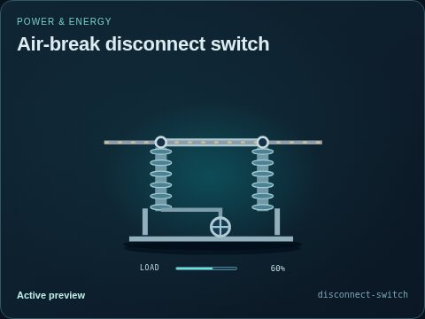
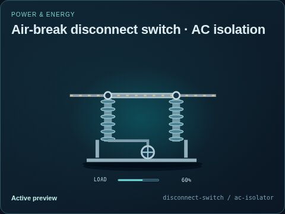

# Air-break disconnect switch

[Parent map](../README.md) · [Package owner](../../../../../README.md) · [Image gallery](../../../../README.md)

Generated previews from canonical equipment artwork and supplied illustrative state. Images do not run a process model. Open a preview for its full size.

| File | Preview | Equipment and supplied state |
| --- | --- | --- |
| [default.jpg](default.jpg) |  | Air-break disconnect switch Fixed illustrative preview `disconnect-switch` |
| [ac-isolator.jpg](ac-isolator.jpg) |  | AC isolation Fixed illustrative preview `disconnect-switch` / `ac-isolator` |
| [dc-isolator.jpg](dc-isolator.jpg) |  | DC isolation Fixed illustrative preview `disconnect-switch` / `dc-isolator` |
