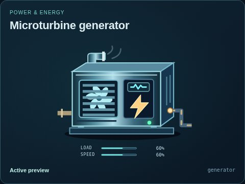
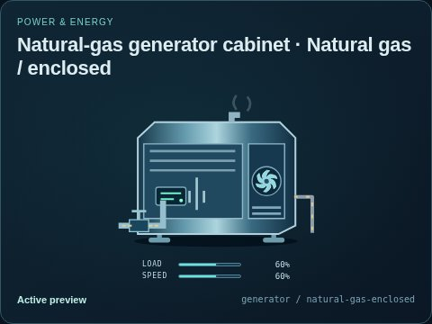
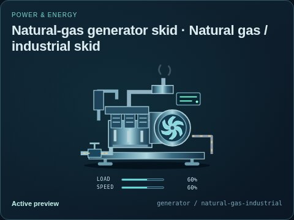
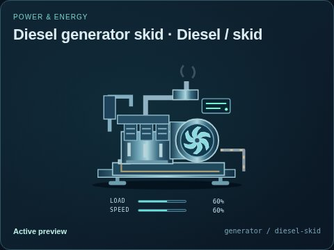
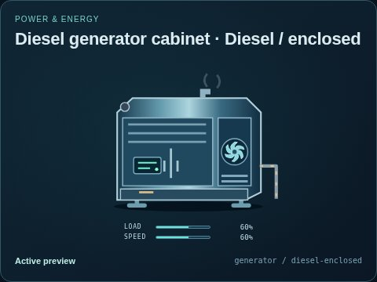
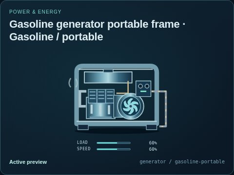

# Microturbine generator

[Parent map](../README.md) · [Package owner](../../../../../README.md) · [Image gallery](../../../../README.md)

Generated previews from canonical equipment artwork and supplied illustrative state. Images do not run a process model. Open a preview for its full size.

| File | Preview | Equipment and supplied state |
| --- | --- | --- |
| [default.jpg](default.jpg) |  | Microturbine generator Fixed illustrative preview `generator` |
| [natural-gas-enclosed.jpg](natural-gas-enclosed.jpg) |  | Natural gas / enclosed Fixed illustrative preview `generator` / `natural-gas-enclosed` |
| [natural-gas-industrial.jpg](natural-gas-industrial.jpg) |  | Natural gas / industrial skid Fixed illustrative preview `generator` / `natural-gas-industrial` |
| [diesel-skid.jpg](diesel-skid.jpg) |  | Diesel / skid Fixed illustrative preview `generator` / `diesel-skid` |
| [diesel-enclosed.jpg](diesel-enclosed.jpg) |  | Diesel / enclosed Fixed illustrative preview `generator` / `diesel-enclosed` |
| [gasoline-portable.jpg](gasoline-portable.jpg) |  | Gasoline / portable Fixed illustrative preview `generator` / `gasoline-portable` |
